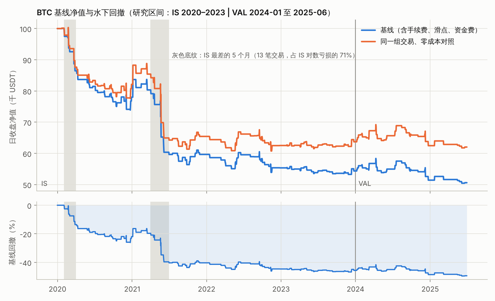
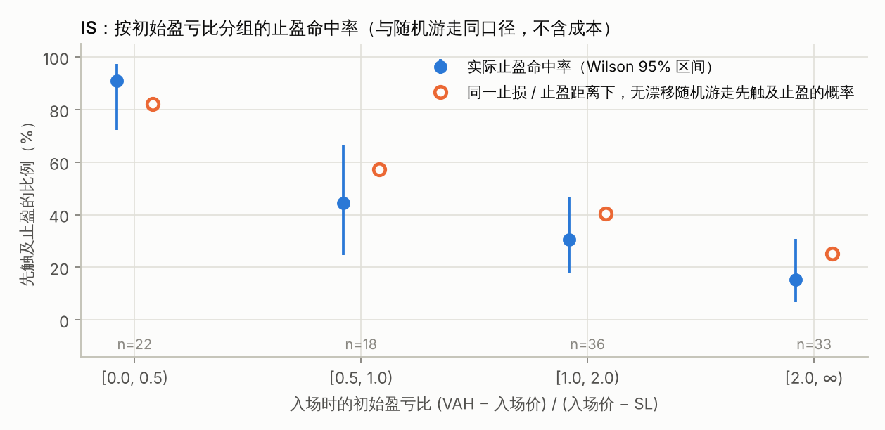
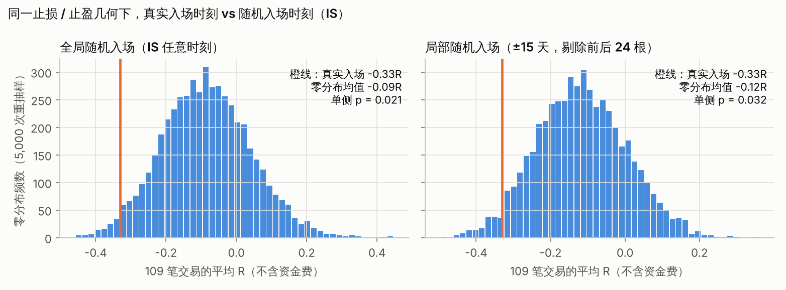
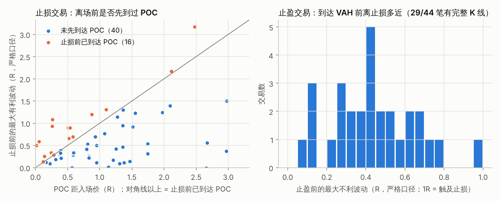
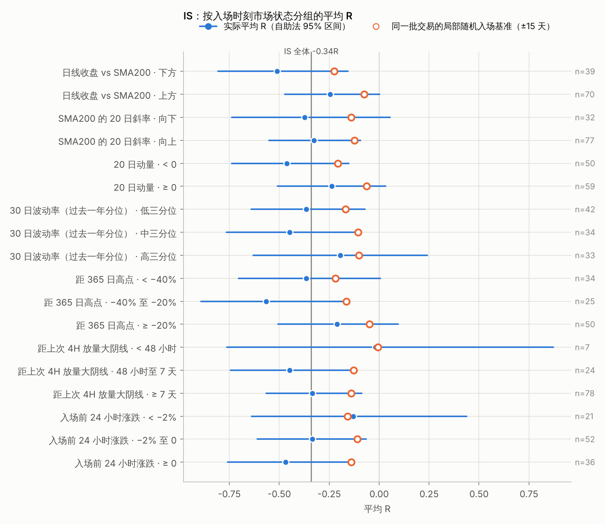

# Phase 2 阶段记录：BTC 基线回测与亏损归因

记录日期：2026-11-05（UTC）。代码基线为 Phase 1 收尾提交 `d1bc53c`。本阶段新增 `attribution.py`、`tools/run_phase2.py`、`test_attribution.py`，并在 `config.py` / `pipeline.py` 中加入 ETH 留出锁。数字由两个脚本生成：`python tools/run_phase2.py`（约 80 秒）生成本阶段的全部分析，原始结果在 `reports/phase2_baseline.json`，本记录的表格 T1–T9 逐字取自同时生成的 `reports/phase2_tables.md`，IS 逐笔交易表在 `reports/phase2_is_trades.csv`，图表在 `reports/figures/phase2_*.png`；`python tools/phase2_review_checks.py`（约 40 秒，只用 IS）重跑复核者在 IS 上试过的 74 个变体，并计算每个变体的零技能公式基准与相对基线的配对夏普差，结果在 `reports/phase2_review_checks.json`。唯一没有入库的数字是第 5 节引用的两个撮合规则核对的 p 值（复核者的脚本，依赖随机种子）。JSON 的 `meta` 记录生成时的代码版本（`git describe --dirty`）与各源文件的 SHA-256 前缀；报告是在提交前的工作区生成的，因此以哈希为准。草稿 `a59f783` 经过三轮独立复核（第一轮三名复核者、第二轮两名、第三轮一名，各配一名怀疑者），第 13 节列出全部发现与处理。

## 0. 结论摘要

基线在 IS 与 VAL 都亏损。IS（2020–2023）日度夏普 −1.17，95% 置信区间 [−2.04, −0.19]，累计 −45.6%，最大回撤 −46.7%。VAL（2024-01 至 2025-06）夏普 −0.53，区间 [−1.93, +1.11]，累计 −6.9%。同期持有 BTC 的夏普分别为 1.00 与 1.47。

亏损主要不是成本造成的（成本约占每笔亏损的三分之一），也不依赖状态机的两项扩展。把手续费、滑点和资金费全部清零，同一组交易的 IS 夏普仍为 −0.86，VAL 为 −0.17。每笔交易平均 −0.34R，其中成本只占 0.12R，扣成本前已是 −0.22R。carry 与 roll 两项扩展开关的四种组合，IS 夏普在 −1.17 到 −0.91 之间，VAL 在 −0.68 到 −0.33 之间。

入场时刻没有优势，并且有一致的迹象显示比随机更差。保持每笔交易的止损、止盈距离不变，只把入场换成随机时刻，真实入场（−0.330R，不含资金费）低于所有不受事后选择影响的随机基准，差距在 0.18R 到 0.26R 之间（下端来自一个部分重放真实交易、因而偏保守的基准），单侧 p 在 0.011 到 0.046 之间。例如：在 IS 任意时刻随机入场为 −0.085R（p = 0.021）；只在策略可执行的 K 线（若出现看涨形态就会发出信号的 440 根）里随机入场为 −0.072R（p = 0.013）；全部入场整体平移、保留聚集结构时为 −0.114R（p = 0.046）。这组检验的方向与窗口划分是在看到初步缺口、并经复核补充之后确定的，14 个零假设彼此不独立，按双侧计 p 约为 0.02 到 0.09，因此只能算一致的提示，不是确认。用同口径的随机游走理论值做解析对照，结论更弱：止盈离场 44 笔，理论期望 50.4 笔，z = −1.36，精确单侧 p = 0.105。

亏损在时间上高度集中，固定 1 倍名义仓位又把它放大了。IS 最差的 5 个月（2020 年 2–3 月、2021 年 4–6 月）贡献了 IS 对数亏损的 71%。这 5 个月内入场的交易只有 13 笔，全部止损离场，平均 −1.07R，止损距离中位数 2.39%，是其余交易（1.17%）的两倍。固定名义仓位下，单笔亏损约等于止损距离：最差一笔（2021-05-22）的止损距离为 8.9%，亏掉净值的 9.0%。

按 R 与按净值看，亏损来源的排序不同。夏普由日度净值收益决定，而固定名义仓位让宽止损交易在净值中的权重更大。按净值算，日线位于 SMA200 下方且 SMA200 下行时入场的 27 笔交易占 IS 净亏损的 32%；20 日动量为负时入场的 50 笔交易占 80%；持仓超过 24 小时的 15 笔交易占 23%。按 R 算，前两组与其余交易的差距要小得多；持仓超过 24 小时的一组按 R 反而好于其余交易（−0.13R 对 −0.37R），它的净值份额完全来自更宽的止损。

IS 中没有任何一个市场状态或结构分组的期望值可靠为正。笔数不少于 5 的 51 个分组里，平均 R（不含资金费）为正的只有两组：盈亏比 < 0.5 的 22 笔（+0.05R，95% 区间 [−0.13, +0.19]，合计只有 +880 USDT），以及入场前 48 小时内出现过 4H 放量大阴线的 7 笔（+0.0004R，实际为零）。把 19 个特征放在一起做置换检验，最大的组间差（2.25 个标准误）落在纯噪声分布的中位数附近（P = 0.61），分组结果整体上不提供超出噪声的证据。

这对 Phase 3 有两个直接后果。第一，基线夏普为负时，随机丢掉一部分交易本身就会把夏普按约 √(保留比例) 推向零，加入零期望的交易也会把它推向零。熔断规则“IS 夏普提升且 VAL 夏普不下降”因此会奖励只是少交易、毫无辨别力的过滤器，判断改进必须扣除这一稀释效应。以 carry / roll 变体为例，扣除稀释后 IS 增量只剩 +0.05 到 +0.14，随机丢掉同样多的信号有 19%–41% 的概率不比它们差。第二，在本样本中以损定仓会降低夏普：它把权重从止损最宽、按 R 相对较好的交易移走（三个止损宽度组内，止损宽度与 R 的秩相关都为正），逐笔“均值 / 标准差”从 −0.263 降到 −0.318。第 11 节据此事先写定 Phase 3 的判定规则，并按机制与成本而不是分组 z 值排列候选。

## 1. 范围与隔离

### 数据与配置

本阶段只经 `pipeline.run("BTCUSDT")` 读取研究数据，即 2020-01-01 00:00 至 2025-06-30 23:00 的 48,191 根永续 1H。`pipeline` 读取整份 parquet 后立即截掉研究末端之后的行，OOS 行不进入任何计算；本阶段把 `spot_daily_warmup` 也改为先截断再重采样（结果不变）。基线配置是 `StrategyConfig()` 与 `BacktestConfig()` 的默认值，key 分别为 `6feffb8a3fb0c7fa` 与 `5bc37091ab0d16cb`，主要取值如下：

- 箱体：4H 枢轴 L = R = 5，最近 2 个已确认枢轴之间的窗口，50 个价格分桶，价值区 70%。
- 支撑带：[VAL − 0.5·ATR, VAL + 0.5·ATR]。
- 两次测试：间隔至少 6 根 1H，或反弹至少 1·ATR。
- 箱体更新时保留同区测试进度，第 2 次测试无形态时滚动为新的第 1 次测试。
- 形态：Pinbar 下影线占振幅 ≥ 60% 且 ≥ 2 倍实体；看涨吞没为完全吞没。
- 止损：两次测试的最低点（吞没形态还包括前一根 K 线低点）− 0.2·ATR；止盈：VAH 全平；仅要求 VAH 高于入场价。
- 执行：永续，计入真实资金费；1 倍净值名义仓位、复利；taker 5bp、maker 2bp、单边滑点 2bp。

### ETH 留出锁

规格要求把 BTC 最终锁定的参数零修改迁移到 ETH 的 2020–2026 全区间。因此 ETH 在任何区间（包括与 BTC 的 IS/VAL 重合的年份）的绩效，在参数锁定前都应视为留出数据。本阶段在 `config.py` 新增 `HOLDOUT_SYMBOLS = ("ETHUSDT",)`。对这些标的，`pipeline.run` 在请求分段指标时抛出 `OOSLockedError`；结构性运行（`segments=()`）只返回箱体与信号，`result` 为 None，不运行回测，也就不产生任何净值或逐笔盈亏。Phase 1 防未来函数闸门对 ETH 的截断比对以 `allow_oos=True` 运行，只输出通过或失败，这是既定例外。这仍是入口约定：绕过 `pipeline` 直接调用 `run_backtest` 不受限制，README 已写明。

### VAL 只报告总体指标

Phase 3 的熔断规则用 VAL 夏普裁决实验。如果假设是从 VAL 的亏损交易里看出来的，VAL 上的改善就部分是样本内拟合，熔断会失去作用。因此本阶段对 VAL 只计算与 IS 同口径的总体指标、夏普置信区间、买入持有基准与成本对照；逐笔归因、分桶、随机入场检验、配对夏普差与全部假设都只来自 IS，VAL 的逐笔交易表不导出，图表只画 IS。唯一的例外是 Phase 1 记录事先承诺的 carry / roll 四种组合（第 3b 节），它们的 VAL 总体指标已经算出并看过，第 3b 节与第 11 节据此标注了受影响的假设。

### 披露

Phase 1 调试期间曾看到研究区间的期末净值与离场原因计数（已在 Phase 1 记录第 7 节披露），当时没有据此改动代码或参数。本阶段草稿（`a59f783`、`f85c142`）的净值图画出了 VAL 段的日度净值路径，我在检查图表时看过；按 VAL 约定，修正后的图只画 IS。复核者为核对第 8、10、11 节的结论，在 IS 上试跑了一批变体（74 个，现由 `tools/phase2_review_checks.py` 复现），只涉及 IS，没有触及 VAL。除 Phase 1 防未来函数闸门外（它在 2020–2026 全量数据上运行 BTC 与 ETH 回测，只输出通过 / 失败，本阶段在仓库的临时副本中运行了它），本阶段没有计算任何 OOS 统计量，也没有运行 ETH 的绩效回测；`pipeline` 读取整份 parquet 后立即截断。

## 2. 基线绩效

日度口径与 Phase 1 一致：日 D 的净值取 D+1 00:00 的盯市净值，空仓日收益为 0，`Sharpe = mean/std × √365`，无风险利率取 0。夏普的置信区间用平稳自助法（Politis–Romano，块长服从均值 10 天的几何分布，5,000 次重抽样，百分位法）。买入持有按 1 单位永续价格计算，不计费用与资金费，只作为参照。

| 指标 | IS 策略 | VAL 策略 | IS 买入持有 | VAL 买入持有 |
|---|---|---|---|---|
| 日度夏普 | −1.174 | −0.525 | 1.001 | 1.466 |
| 夏普 95% 区间 | [−2.043, −0.190] | [−1.932, +1.108] |  |  |
| 自助样本中夏普 > 0 的比例 | 1.1% | 24.9% |  |  |
| Sortino | −1.387 | −0.658 | 1.447 | 2.322 |
| Calmar | −0.302 | −0.344 | 0.727 | 3.054 |
| CAGR | −14.12% | −4.67% | 55.71% | 85.82% |
| 累计收益 | −45.63% | −6.92% | +488.56% | +153.08% |
| 最大回撤（日收盘，分段内） | −46.75% | −13.59% | −76.67% | −28.10% |
| 最大回撤（逐小时盯市，分段内） | −47.01% | −14.41% |  |  |
| 年化波动 | 12.31% | 8.43% | 67.99% | 51.13% |
| 持仓时间占比 | 4.08% | 3.25% | 100% | 100% |
| 交易笔数（止损 / 止盈） | 109（65 / 44） | 30（17 / 13） |  |  |
| 胜率（净盈亏 > 0） | 36.70% | 40.00% |  |  |
| 盈亏比（Profit Factor） | 0.450 | 0.698 |  |  |
| 平均 R | −0.340 | −0.255 |  |  |
| 平均持仓（1H 根数） | 13.1 | 14.2 |  |  |
| 手续费 / 资金费（USDT） | 6,390 / 1,439 | 1,415 / 375 |  |  |

信号与成交的对应关系如下。IS 共 120 个原始信号，其中 3 个因 VAH 不高于信号收盘被拦下，另有 8 个出现在持仓期间而未成交，实际入场 109 笔。VAL 共 32 个原始信号，1 个被拦下、1 个因持仓未成交，实际入场 30 笔。研究区间合计 139 笔。

VAL 夏普单独的置信区间宽约 3.0，但 Phase 3 比较的是同一批信号的两个变体，两者的日度收益高度相关，判定真正面对的是夏普差的不确定性，它比单独的区间窄。以 IS 为例，第 3b 节三个状态机变体相对基线的配对夏普差，95% 区间宽度为 0.54–0.61，而 IS 夏普单独的区间宽 1.85；配对差的区间随变体改动的交易增加而变宽：`tools/phase2_review_checks.py` 对收益与基线不同的 71 个复核变体测得 0.20–2.55；在改变了交易集合的 65 个变体里，区间宽度与“和基线不同的交易笔数”的 Spearman 相关为 0.85，2–8 小时的时间止损最宽（2.23–2.55）。VAL 只有 IS 的约 37% 天数，配对差的区间会更宽。配对夏普差本身也带着第 0 节所说的稀释偏差：随机去掉 13% 的交易，夏普平均就提高约 0.07（第 3b 节：稀释后 −1.099，基线 −1.174）。`attribution.paired_sharpe_diff` 用同一组重抽样下标计算两个变体的夏普差，Phase 3 会把它与稀释基准一起报告（第 11 节）。

## 3. 成本对照

下表各对照组使用完全相同的一组交易（脚本断言了每个对照组的入场与离场 K 线与基线逐笔相同），只改变成本参数。

| 对照组 | IS 夏普 | IS 累计 | VAL 夏普 | VAL 累计 |
|---|---|---|---|---|
| 基线（taker 5bp、maker 2bp、滑点 2bp、资金费） | −1.174 | −45.63% | −0.525 | −6.92% |
| 不计资金费 | −1.135 | −44.59% | −0.472 | −6.28% |
| 不计滑点 | −1.089 | −43.21% | −0.432 | −5.80% |
| 不计手续费 | −0.990 | −40.15% | −0.323 | −4.46% |
| 零成本 | −0.863 | −36.29% | −0.173 | −2.64% |
| 现货等效（taker / maker 各 10bp、滑点 2bp、无资金费、名义 ≤ 净值 / (1 + taker)） | −1.374 | −50.95% | −0.738 | −9.41% |

按笔拆分，IS 每笔交易的成本折合 0.119R：手续费 0.075R、滑点 0.034R、资金费 0.010R。IS 合计扣成本前盈亏 −34,908 USDT，再扣滑点 2,897、手续费 6,390、资金费 1,439，得到净盈亏 −45,634。成本约占每笔亏损的三分之一，剩下的三分之二在扣成本之前就已存在。

有一类交易几乎只是在付成本。14 笔交易的止盈距离不到止盈往返成本（11bp）的 3 倍，其中 4 笔虽以止盈离场，净盈亏仍为负（止盈距离只有 1.0–3.7bp）。这 14 笔都是窄箱体信号：箱体宽度 1.1–2.6·ATR，低于全部交易的中位数 3.3·ATR；信号收盘位于箱体 45%–99% 的高度，中位数约 80%。Phase 1 第 11 节记录的同类计数是 BTC 研究期 6 笔，那是第一轮审计时的代码（`ee26506`）在 IS + VAL 上的计数；按本阶段的 VAL 约定，这里只给出 IS 的 4 笔。

## 3b. 基线定义的敏感性：carry 与 roll

carry（新箱体与本轮第 1 次测试同区时保留测试进度）与 roll（第 2 次测试无形态即离开时滚动为新的第 1 次测试）是规格之外的状态机扩展。Phase 1 记录承诺在 Phase 2 同时报告二者开、关时的基线。下表四组使用相同的执行配置，只报告总体指标；配对夏普差只在 IS 上计算。

| 状态机扩展 | IS 原始信号 / 入场 | IS 夏普 | IS 配对夏普差 [95%] | IS 稀释基准（经验 / 公式；稀释后平均笔数） | IS 扣除稀释后的增量 | 稀释下不差于该变体的概率 | IS 平均 R | VAL 原始信号 / 入场 | VAL 夏普 | VAL 稀释公式基准 | VAL 平均 R |
|---|---|---|---|---|---|---|---|---|---|---|---|
| carry 开、roll 开（基线） | 120 / 109 | −1.174 | — | — | — | — | −0.340 | 32 / 30 | −0.525 | — | −0.255 |
| carry 关 | 98 / 91 | −1.044 | +0.131 [−0.12, +0.42] | −1.095 / −1.073；90.8 | +0.051 | 0.409 | −0.410 | 25 / 24 | −0.676 | −0.470 | −0.372 |
| roll 关 | 104 / 95 | −0.961 | +0.213 [−0.03, +0.56] | −1.099 / −1.096；95.2 | +0.138 | 0.193 | −0.297 | 29 / 27 | −0.335 | −0.498 | −0.213 |
| 二者都关 | 90 / 85 | −0.911 | +0.263 [−0.01, +0.60] | −1.051 / −1.037；85.4 | +0.141 | 0.209 | −0.357 | 24 / 23 | −0.530 | −0.460 | −0.342 |

四种定义在 IS 与 VAL 都亏损，结论不依赖这两项扩展。正式基线仍按 Phase 1 的定义（二者都开），不因上表改变。

三个变体都比基线少交易，夏普的一部分“改善”只是稀释。表中的稀释基准是把基线的每个可交易信号以相同概率随机保留后重跑回测的 IS 夏普（每组 300 次，经验分布）。丢掉信号会让此前因持仓而跳过的信号成交，因此保留概率先用同一组随机数二分校准，使稀释后的平均入场笔数等于变体的笔数（表中“稀释后平均笔数”）；公式值 S_ref × √(n / n_ref) 与经验值接近。扣除后，关闭 roll 与两者都关的 IS 增量约 +0.14，关闭 carry 约 +0.05；随机丢信号有 19%、21% 与 41% 的概率不比它们差。关闭 carry 的平均 R 还更差（−0.410 对 −0.340）。

按第 11 节事先写定的规则、以本基线为现任，这三组都会被否决：关闭 carry 与两者都关的 VAL 夏普低于基线（规则 2 与 3），关闭 roll 的稀释概率 0.19 高于 0.10（规则 4）。三组都保留为 Phase 3 的候选 H0，但只有在现任配置改变之后重跑才有意义，优先级放在最后。这三组的 VAL 结果已在本阶段看过，Phase 3 对它们的判定中 VAL 不是独立证据，台账会标注这一点。

## 4. 期望值结构

IS 胜率 36.7%（40/109）。盈利交易平均 +0.892R，亏损交易平均 −1.054R，盈亏平衡所需胜率为 54.2%。盈利交易的初始盈亏比中位数只有 0.80，亏损交易为 1.68。也就是说，能赢的主要是目标很近的交易，目标较远的交易大多先被止损。这本身符合随机游走：价格从信号收盘 C 出发、止损为 SL、止盈为 TP 时，无漂移连续随机游走先触及止盈的概率是 (C − SL) / (TP − SL)。起点取信号收盘而不是含滑点的成交价，因为 SL 与 TP 都按原始高低价触发。

这个概率不含成本，与它同口径的是止盈离场笔数，而不是净盈利笔数。IS 有 44 笔止盈离场，逐笔求和的期望为 50.4 笔（标准差 4.7），z = −1.36，泊松二项分布的精确单侧 p = 0.105。若把“即使止盈也净亏”的交易（4 笔，止盈距离 1.0–3.7bp）的期望置 0，与不含资金费的净盈利笔数比较，实际 40 笔、期望 46.5 笔，z = −1.39，p = 0.100。解析对照本身不显著。

分组来看（下图），盈亏比 < 0.5 的 22 笔交易止盈命中率 90.9%，高于随机游走的 80.8%；盈亏比 0.5–1、1–2、≥ 2 三组的命中率分别比理论值低 11.9、9.1、9.6 个百分点。缺口集中在盈亏比 ≥ 0.5 的交易上。盈亏比 < 0.5 的一组在金额上几乎为零：止盈距离中位数只有 0.25%，中位持仓 1 根 K 线，22 笔合计 +880 USDT，其中 4 笔止盈后仍因成本净亏。

## 5. 入场时机检验：随机入场零假设

第 4 节的解析对照没有考虑漂移、离散 K 线、悲观撮合与成本。为此做了经验零假设。对每笔真实交易，保持它相对入场成交价的止损距离与止盈距离不变，把入场换成随机抽取的一根 1H K 线的收盘，按与回测器完全相同的规则撮合：止损优先、止损成交价取 min(开盘价, SL)、止盈按 TP 成交、单边滑点、入场与止损收 taker、止盈收 maker。资金费两边都不计，比较量是不含资金费的平均 R。每个零假设重抽样 5,000 次，每次为 109 笔交易各抽一个入场时刻。

撮合函数在 139 笔研究期真实交易的真实入场 K 线上逐笔复现了回测器的离场 K 线、离场原因与不含资金费的 R，误差不超过 1e-12（`test_bracket_reproduces_backtester_on_research_trades`）。取样窗口缩小到只能抽到真实信号 K 线时，零分布退化为真实结果（`test_local_null_with_tiny_window_degenerates_to_actual`），这同时校验了窗口中心与撮合口径。

| 零假设的取样范围 | 零假设平均 R | 零假设 90% 区间 | 单侧 p（平均 R） | 零假设胜笔数（真实 40） | 单侧 p（胜笔数） |
|---|---|---|---|---|---|
| IS 任意时刻 | −0.085 | [−0.288, +0.128] | 0.021 | 47.0 | 0.085 |
| 信号前后 60 天 | −0.080 | [−0.285, +0.128] | 0.023 | 47.2 | 0.076 |
| 信号前后 15 天 | −0.130 | [−0.323, +0.071] | 0.046 | 45.7 | 0.125 |
| 信号前后 15 天，剔除前后 24 根 | −0.117 | [−0.308, +0.084] | 0.032 | 46.3 | 0.104 |
| 信号前后 3 天 | −0.220 | [−0.398, −0.030] | 0.163 | 42.6 | 0.328 |
| 信号前 3 天 | −0.321 | [−0.479, −0.151] | 0.476 | 38.8 | 0.655 |
| 信号后 3 天 | −0.113 | [−0.287, +0.073] | 0.019 | 46.5 | 0.083 |
| 信号后第 25 根至 3 天 | −0.092 | [−0.260, +0.089] | 0.011 | 47.3 | 0.042 |
| 可执行 K 线池，IS 任意时刻 | −0.072 | [−0.267, +0.137] | 0.013 | 47.9 | 0.052 |
| 可执行 K 线池，信号前后 15 天 | −0.153 | [−0.325, +0.024] | 0.045 | 45.3 | 0.114 |
| 可执行 K 线池，信号前后 15 天，剔除信号 K 线本身 | −0.140 | [−0.304, +0.032] | 0.030 | 45.6 | 0.099 |
| ATR 几何，IS 任意时刻 | −0.088 | [−0.287, +0.117] | 0.024 | 47.1 | 0.078 |
| ATR 几何，信号前后 15 天，剔除前后 24 根 | −0.107 | [−0.298, +0.097] | 0.028 | 45.8 | 0.127 |
| 全部入场整体平移 ±25–360 根（保留聚集结构，672 次） | −0.114 | [−0.328, +0.090] | 0.046 | — | — |

真实入场的平均 R 为 −0.330（不含资金费），低于表中每一个零假设。各零假设的含义如下：

- 在 IS 任意时刻、信号前后 60 天内随机入场，平均约为 −0.08R，p 约 0.02。信号所处的月度行情不能解释差距。
- 信号前后 15 天内取样时，零假设降到 −0.130R；剔除与真实交易共享路径的前后 24 根 K 线后为 −0.117R（p = 0.032）。半个月尺度的行情环境只解释约 0.03R。
- 信号前后 3 天的对称窗口降到 −0.220R（p = 0.163），这几乎全部来自信号之前的 3 天（−0.321R）。这段窗口不是公平的基准：它是由“随后价格回落进支撑带并形成信号”这一事后结果选出来的，在其中随机做多等于事先知道价格接下来要下跌。
- 只在信号之后取样，信号后 3 天为 −0.113R（p = 0.019），剔除前 24 根后为 −0.092R（p = 0.011）。在信号之后的几天里随机做多，表现与 IS 任意时刻相当，而在信号收盘立即入场要差 0.22–0.24R。
- 只在策略可执行的 K 线里随机入场。可执行指若此根出现看涨形态就会在收盘发出信号：处理后状态为 TOUCH2、触及支撑带且收盘不低于带下沿，或本身就是信号 K 线。IS 共 440 根，包含全部 109 个真实入场；测试在每根抽样 K 线上强加一个 Pinbar，核对信号确实会、或确实不会发出。结果：IS 任意时刻为 −0.072R（p = 0.013），信号前后 15 天为 −0.153R（p = 0.045）。这是与策略可执行范围一致的基准，差距 0.18–0.26R。其中 15 天一行偏保守：每笔交易在窗口内的可执行 K 线中位数只有 10 根（2–24 根），约 12% 的抽样就是真实信号 K 线本身，约三分之一落在信号前后 24 根以内，相当于部分重放真实交易。去掉每笔交易自身的信号 K 线后为 −0.140R（p = 0.030），差距 0.19R；此时仍有约四分之一的抽样落在前后 24 根以内。
- 以入场时 ATR 计的距离代替百分比距离，结果几乎不变（−0.088R，p = 0.024；15 天、剔除 24 根时 −0.107R，p = 0.028）。
- 全部入场整体平移同一个偏移，保留真实入场的聚集结构。偏移取 ±25 到 ±360 根，共 672 次；与局部零假设剔除前后 24 根的理由相同，更小的偏移基本是在重放真实交易自己的路径。零假设为 −0.114R，p = 0.046。

综合起来：在所有不受事后选择影响的零假设下（即除对称 ±3 天与信号前 3 天两行之外），真实入场都比随机入场差 0.18–0.26R，单侧 p 从 0.011 到 0.046。入场没有优势这一点是稳健的；“显著地比随机更差”是一致的提示，但受事后设计与多个相关检验的限制，不是确认。

入场后的价格漂移方向与此一致，但都不显著。信号收盘后 4 小时与 12 小时的平均对数收益为 −0.18% 与 −0.19%，同期全部 IS K 线为 +0.02% 与 +0.06%，t 值分别为 −1.55 与 −1.21。24 小时与 48 小时后的差值转为正，t 值为 +0.85 与 +0.27。

这一检验有三点局限与两项已做的核对：

- 设计是事后的。全局零假设的单侧方向是在看到第 4 节的解析缺口之后确定的；信号前 / 后的拆分、可执行 K 线池与整体平移是复核阶段加的，剔除信号 K 线本身的一行是第三轮复核加的。按双侧计，表中 p 值约翻倍。
- 十四个零假设彼此不独立，不能当作十四次独立的确认。
- 比较量是平均 R，不含资金费；资金费平均只有 0.010R。
- 核对一：几何口径。上表的 ATR 几何两行显示，用 ATR 倍数代替百分比距离不改变结论。
- 核对二：撮合规则。真实交易里止损与止盈在同一根 K 线同时触及的只有 1 笔（0.9%），全局零假设中为 1.9%。复核者把同一根 K 线的撮合规则改为“止盈优先”或“按与开盘价的距离判先后”，同时用于真实交易与零假设，全局检验的 p 约为 0.02 与 0.015（取决于随机种子；该核对脚本未入库），结论不变。

## 6. 出场路径

严格口径只使用入场 K 线之后、离场 K 线之前的完整 K 线。离场 K 线内高低点的先后顺序未知，所以“止损前曾到达 POC”在这个口径下是下限。

止损离场的 65 笔交易中，57 笔的 POC 高于入场价。其中 56 笔在离场前至少有一根完整 K 线，16 笔在止损前已经到达 POC。28 笔曾有至少 +0.5R 的有利波动，14 笔曾到 +1R；另有 3 笔在离场前的完整 K 线里从未高于入场价。有利波动的中位数为 0.44R，持仓中位数 8 小时。IS 的 65 笔止损没有一笔按跳空开盘价成交。6 笔止损的实际亏损超过 1.2R，原因是止损距离很窄（0.26%–0.62%），固定的手续费与滑点折合 0.24–0.54R。

止盈离场的 44 笔交易中，15 笔在入场后的第一根 K 线就触及 VAH。其余 29 笔在止盈前的最大不利波动中位数为 0.44R，10 笔超过 0.5R，1 笔超过 0.8R。这 44 笔中有 26 笔的 POC 高于入场价，如果改为在 POC 分批止盈，这 26 笔的部分仓位会提前在 POC 平掉。

持仓时间很短：109 笔中 42 笔在 4 小时内离场，持仓时间只占 IS 的 4.1%，规格中“资金长期滞留在震荡中拉低日度夏普”的情形在基线上基本不存在。但长持仓交易的净值亏损并不小：持仓超过 12 小时的 33 笔占 IS 净亏损的 43%，超过 24 小时的 15 笔占 23%，超过 48 小时的 7 笔占 11%（第 8 节 T7）。按 R 看则相反，这几组都好于其余交易（例如超过 24 小时的一组 −0.13R，其余 −0.37R）；它们的净值份额来自更宽的止损（止损距离中位数 1.87%，其余 1.19%）。时间止损对夏普的作用因此不能按笔数或按 R 预判。复核者在 IS 上的试跑（`reports/phase2_review_checks.json`）显示，夏普对止损时长的反应很不规则：6 小时 −0.45，相邻的 5、7 小时为 −0.91、−0.71；24 小时 −0.96，相邻的 22、26 小时为 −1.10、−1.14。Phase 3 按规则 5 把每个候选时长连同邻点一起跑（4 个候选、共 12 个时长），并按高原增量（候选与邻点 IS 增量中的最小值）排序，不能只看单个时长。

## 7. 结构与形态分组（IS）

下表摘录各结构特征的分组结果（全部分组见 JSON 的 `is_entry_buckets`）。分组边界是事先选定的整数或常用阈值。

- 止盈命中率与随机游走理论值同口径（都不含成本）。
- 平均 R 不含资金费，区间为自助法 95% 区间。
- 零假设平均 R 是同一批交易在“信号前后 15 天、剔除前后 24 根”随机入场下的期望 R。超额 R 等于平均 R 减零假设平均 R，用来区分“这类行情里做多本来就难”与“信号在这类行情里选得更差”。
- 每笔净值盈亏是每笔盈亏占入场时净值的平均值。对数亏损份额是组内交易 log(1 + 每笔净值收益) 之和占 IS 全部之和的比例。复利、单仓位下，后者恰好等于 IS 期末与期初净值之比的对数（JSON `is_log_identity` 逐位核对）。

| 特征 | 分组 | 笔数 | 止盈命中率 | 随机游走理论 | 平均 R（不含资金费）[95%] | 零假设平均 R | 超额 R [95%] | 每笔净值盈亏 | 占 IS 对数亏损 |
|---|---|---|---|---|---|---|---|---|---|
| 初始盈亏比 | < 0.5 | 22 | 90.9% | 80.8% | +0.05 [−0.13, +0.19] | −0.08 | +0.13 [−0.03, +0.27] | +0.10% | −3% |
|  | 0.5–1 | 18 | 44.4% | 56.4% | −0.29 [−0.71, +0.12] | −0.11 | −0.19 [−0.61, +0.24] | +0.04% | 0% |
|  | 1–2 | 36 | 30.6% | 39.7% | −0.34 [−0.70, +0.04] | −0.10 | −0.24 [−0.62, +0.16] | −0.95% | 58% |
|  | ≥ 2 | 33 | 15.2% | 24.7% | −0.59 [−0.99, −0.14] | −0.16 | −0.43 [−0.85, +0.07] | −0.83% | 46% |
| 箱体宽度 (VAH−VAL)/ATR | < 2.5 | 30 | 70.0% | 67.4% | −0.07 [−0.35, +0.23] | −0.12 | +0.05 [−0.23, +0.36] | −0.06% | 3% |
|  | 2.5–4 | 42 | 35.7% | 44.4% | −0.35 [−0.67, −0.01] | −0.13 | −0.22 [−0.55, +0.13] | −0.83% | 59% |
|  | ≥ 4 | 37 | 21.6% | 31.1% | −0.52 [−0.87, −0.09] | −0.10 | −0.42 [−0.77, −0.01] | −0.59% | 38% |
| 止损距离 d_sl | < 1% | 31 | 38.7% | 42.3% | −0.43 [−0.78, −0.06] | −0.20 | −0.23 [−0.60, +0.17] | −0.27% | 14% |
|  | 1%–2% | 53 | 41.5% | 45.7% | −0.22 [−0.53, +0.12] | −0.09 | −0.13 [−0.45, +0.21] | −0.33% | 30% |
|  | ≥ 2% | 25 | 40.0% | 52.1% | −0.45 [−0.74, −0.13] | −0.07 | −0.37 [−0.64, −0.11] | −1.31% | 56% |
| 形态 | Pinbar | 60 | 33.3% | 43.1% | −0.45 [−0.70, −0.17] | −0.15 | −0.30 [−0.55, −0.01] | −0.83% | 84% |
|  | 吞没 | 46 | 50.0% | 50.3% | −0.18 [−0.48, +0.13] | −0.09 | −0.09 [−0.39, +0.24] | −0.11% | 9% |
| 箱体枢轴方向 | 高→低（下跌段） | 54 | 37.0% | 45.9% | −0.43 [−0.68, −0.14] | −0.09 | −0.34 [−0.59, −0.07] | −0.57% | 52% |
|  | 低→高（上涨段） | 34 | 50.0% | 48.3% | −0.09 [−0.46, +0.29] | −0.08 | −0.01 [−0.41, +0.40] | −0.22% | 14% |
| 第 2 次测试扫破第 1 次低点 | 否 | 58 | 37.9% | 50.2% | −0.40 [−0.66, −0.11] | −0.13 | −0.27 [−0.53, +0.01] | −0.74% | 73% |
|  | 是 | 51 | 43.1% | 41.7% | −0.25 [−0.54, +0.05] | −0.10 | −0.15 [−0.44, +0.16] | −0.31% | 27% |
| 箱体可用后多久入场 | < 12 小时 | 49 | 36.7% | 48.6% | −0.43 [−0.70, −0.12] | −0.11 | −0.32 [−0.61, −0.01] | −0.67% | 55% |
|  | 12–48 小时 | 58 | 43.1% | 43.5% | −0.24 [−0.52, +0.04] | −0.13 | −0.11 [−0.39, +0.18] | −0.39% | 40% |

组间比较按超额 R 之差除以两组自助法标准误的合成值：

- 宽箱体（≥ 4·ATR）与窄箱体（< 2.5·ATR）相差 0.47R，约 1.9 个标准误。
- 盈亏比两端（≥ 2 与 < 0.5）相差 0.56R，约 2.2 个标准误。
- 下跌段箱体（先高点后低点，VAL 位于一段下跌的成交密集区）比上涨段箱体差 0.33R，约 1.4 个标准误。
- Pinbar 比吞没差 0.21R，约 1.0 个标准误；按平均 R 是 0.27R，约 1.3 个标准误。

箱体宽度与初始盈亏比高度相关（Spearman 0.73），衡量的基本是同一件事，即 VAH 离入场价有多远。

止盈命中率提供了另一个角度。窄箱体（70.0% 对理论 67.4%）、吞没（50.0% 对 50.3%）、上涨段箱体（50.0% 对 48.3%）、扫破第 1 次低点的第 2 次测试（43.1% 对 41.7%）几组的命中率与随机游走相当。宽箱体、Pinbar、下跌段箱体、未扫破第 1 次低点、箱体可用后 12 小时内入场几组，则比理论值低约 9–12 个百分点。

这些比较是探索性的，而且整体检验表明它们处在噪声水平。结构与市场状态两节合计 19 个特征、56 个分组。把每笔交易的超额 R 在 109 笔交易之间随机置换 2,000 次（特征不动，保留特征之间的相关），每次取全部特征中笔数 ≥ 15 的组间最大 Welch z：置换分布的中位数为 2.40，95% 分位为 3.53，观测到的最大值 2.25（盈亏比）对应 P = 0.61；z ≥ 1.9 的特征观测到 1 个，纯噪声下平均 2.0 个。因此组间差只能作为 Phase 3 的待检验假设，不能作为证据强弱的排序依据。

## 8. 市场状态分组（IS）

市场状态特征全部在信号 K 线收盘时计算，只使用此前已收盘的数据：日线 D 于 D+1 00:00 可用（2020 年以前用现货日线预热），4H 于收盘可用，1H 收益取到信号 K 线收盘为止。`test_regime_features_are_causal` 在截断到决策 K 线的数据上重算这些特征，与全量研究数据上的结果逐位一致。

| 特征 | 分组 | 笔数 | 止盈命中率 | 随机游走理论 | 平均 R（不含资金费）[95%] | 零假设平均 R | 超额 R [95%] | 每笔净值盈亏 | 占 IS 对数亏损 |
|---|---|---|---|---|---|---|---|---|---|
| 日线收盘 vs SMA200 | 下方 | 39 | 30.8% | 43.4% | −0.51 [−0.81, −0.16] | −0.22 | −0.29 [−0.59, +0.07] | −1.13% | 75% |
|  | 上方 | 70 | 45.7% | 47.8% | −0.23 [−0.47, +0.03] | −0.06 | −0.17 [−0.42, +0.08] | −0.20% | 25% |
| 20 日动量 | < 0 | 50 | 34.0% | 44.8% | −0.46 [−0.73, −0.16] | −0.20 | −0.26 [−0.54, +0.05] | −0.98% | 83% |
|  | ≥ 0 | 59 | 45.8% | 47.4% | −0.22 [−0.49, +0.06] | −0.05 | −0.17 [−0.45, +0.11] | −0.16% | 17% |
| 距 365 日高点 | < −40% | 34 | 38.2% | 44.4% | −0.36 [−0.72, +0.04] | −0.22 | −0.14 [−0.49, +0.26] | −0.96% | 55% |
|  | −40% 至 −20% | 25 | 28.0% | 46.2% | −0.55 [−0.90, −0.17] | −0.15 | −0.41 [−0.77, +0.01] | −1.00% | 42% |
|  | ≥ −20% | 50 | 48.0% | 47.5% | −0.20 [−0.49, +0.11] | −0.03 | −0.17 [−0.47, +0.14] | −0.02% | 3% |
| 距上次 4H 放量大阴线 | < 48 小时 | 7 | 57.1% | 50.1% | 0.00 [−0.75, +1.00] | +0.02 | −0.02 [−0.80, +0.92] | −0.50% | 6% |
|  | 48 小时至 7 天 | 24 | 45.8% | 55.3% | −0.44 [−0.74, −0.13] | −0.11 | −0.33 [−0.62, −0.04] | −0.47% | 19% |
|  | ≥ 7 天 | 78 | 37.2% | 43.1% | −0.33 [−0.57, −0.07] | −0.13 | −0.19 [−0.45, +0.08] | −0.56% | 75% |
| 入场前 24 小时涨跌 | < −2% | 21 | 38.1% | 39.9% | −0.12 [−0.66, +0.49] | −0.14 | +0.02 [−0.52, +0.63] | −0.56% | 22% |
|  | −2% 至 0 | 52 | 44.2% | 49.1% | −0.32 [−0.59, −0.06] | −0.09 | −0.23 [−0.52, +0.06] | −0.28% | 25% |
|  | ≥ 0 | 36 | 36.1% | 45.8% | −0.46 [−0.76, −0.13] | −0.14 | −0.32 [−0.61, +0.01] | −0.89% | 54% |
| 30 日波动率分位 | 低三分位 | 42 | 47.6% | 53.5% | −0.35 [−0.63, −0.05] | −0.16 | −0.19 [−0.48, +0.11] | −0.43% | 30% |
|  | 中三分位 | 34 | 35.3% | 45.0% | −0.44 [−0.75, −0.12] | −0.09 | −0.35 [−0.66, −0.02] | −0.52% | 29% |
|  | 高三分位 | 33 | 36.4% | 38.3% | −0.19 [−0.60, +0.28] | −0.09 | −0.10 [−0.54, +0.37] | −0.69% | 40% |
| SMA200 的 20 日斜率 | 向下 | 32 | 34.4% | 44.6% | −0.36 [−0.74, +0.06] | −0.13 | −0.23 [−0.61, +0.22] | −0.70% | 38% |
|  | 向上 | 77 | 42.9% | 46.9% | −0.32 [−0.54, −0.08] | −0.11 | −0.21 [−0.43, +0.03] | −0.47% | 62% |

按 R 看，空头一侧的分组更差，但一半以上的差距是同期随机做多也会承受的：

- 日线位于 SMA200 下方与上方相比，平均 R 差 0.27R，其中 58% 由零假设解释，超额 R 只差 0.11R（约 0.5 个标准误）。
- 20 日动量为负与为正相比，零假设解释 63%，超额 R 差 0.09R（约 0.4 个标准误）。
- 距 365 日高点 −20% 以下与以上相比，零假设解释 64%。

按净值看，同样几组的差距大得多：SMA200 下方每笔 −1.13%（上方 −0.20%），20 日动量为负每笔 −0.98%（为正 −0.16%）。两种口径的差异来自止损宽度：空头行情里 ATR 大、止损宽，固定名义仓位下每笔亏损按止损距离放大（第 10 节）。夏普取决于净值口径的日度收益，所以这些分组对夏普的拖累，比 R 口径显示的大。

“只做多策略的头号亏损来源是在单边瀑布中接飞刀”这一先验，分两个层面看：

- 宏观层面，空头行情中的交易贡献了大部分亏损（SMA200 下方 39 笔占 IS 对数亏损的 75%，20 日动量为负的 50 笔占 83%）。但其中多数是行情本身的负漂移加上更宽的止损，信号在空头行情里并没有比在其他行情里选得明显更差。
- 微观层面，数据不支持这一先验。入场前 24 小时上涨的 36 笔交易在两种口径下都最差（−0.46R，每笔 −0.89%）。入场前 24 小时跌幅超过 2% 的 21 笔按 R 最不差（−0.12R），按净值每笔 −0.56%、居中，但这完全来自其中最差的一笔（2021-05-22，入场前 24 小时 −8.7%，亏掉净值 9.0%）；去掉这一笔，该组每笔 −0.14%，同样最不差。入场前 48 小时内出现过 4H 放量大阴线（即处于冷却期内）的只有 7 笔。

按 R 看，30 日波动率分位的三组没有单调关系，SMA200 斜率两组的平均 R 只差 0.04R，都不支持过滤。按净值看则不同：波动率越高，每笔亏损越大（−0.43%、−0.52%、−0.69%）；SMA200 下行组每笔 −0.70%（上行 −0.47%），与 `daily_sma` 标记组相当。这两项的净值差距主要来自更宽的止损，与 H1、H6 重叠。

| 预览 | 标记笔数 | 标记组平均 R | 保留组平均 R | 标记组每笔净值盈亏 | 保留组每笔净值盈亏 | 标记组占 IS 净亏损 | 标记组占 IS 对数亏损 |
|---|---|---|---|---|---|---|---|
| daily_sma（收盘低于 SMA200 且 SMA200 的 20 日斜率为负） | 27 | −0.40 | −0.32 | −0.70% | −0.48% | 32% | 32% |
| crash_cooldown（4H 放量大阴线后 48 小时） | 7 | −0.02 | −0.36 | −0.50% | −0.54% | 9% | 6% |
| 20 日动量为负（未实现） | 50 | −0.46 | −0.24 | −0.98% | −0.16% | 80% | 83% |
| 持仓超过 12 小时（时间止损的作用对象） | 33 | −0.12 | −0.44 | −0.69% | −0.47% | 43% | 40% |
| 持仓超过 24 小时（时间止损的作用对象） | 15 | −0.13 | −0.37 | −0.86% | −0.48% | 23% | 23% |
| 持仓超过 48 小时（时间止损的作用对象） | 7 | −0.22 | −0.35 | −0.87% | −0.51% | 11% | 10% |

上表只看被标记交易本身的结果，不是回测实验。过滤器释放的仓位可能让此前因持仓而跳过的信号成交，时间止损也会改变后续入场，真实效果以 Phase 3 为准。按净值口径：

- `daily_sma` 标记的 27 笔每笔 −0.70%，保留部分 −0.48%，占 IS 净亏损的 32%。效果可能是实质性的，比 R 口径（−0.40R 对 −0.32R）显示的大。
- `crash_cooldown` 标记的 7 笔每笔 −0.50%，保留部分 −0.54%，两者相当，预期作用接近于零。
- 20 日动量为负覆盖 80% 的净亏损，但这个过滤器目前没有实现，而且会拿掉 46% 的交易。

## 9. 回撤来源与时间分布

IS 的日收盘净值只有一个回撤区间：2020-02-02 日收盘创出峰值后再未创新高（2020-12-23 回撤 −26.1%，2021-03-13 曾回升到 −16.3%），到 2023-11-27 达到谷底 −46.75%，IS 结束前没有收复。109 笔交易中有 106 笔在这个区间内平仓，合计 −38.4R。因此“回撤来源”实际上就是整个 IS 的负期望，再叠加两段集中亏损。

| 年份 | 笔数 | 胜率 | 平均 R | 盈亏（USDT） |
|---|---|---|---|---|
| 2020 | 32 | 31.2% | −0.52 | −21,999 |
| 2021 | 28 | 32.1% | −0.34 | −18,337 |
| 2022 | 21 | 28.6% | −0.26 | −4,310 |
| 2023 | 28 | 53.6% | −0.20 | −988 |

最差的 5 个月是 2021-05（−13.78%）、2020-03（−7.75%）、2021-06（−7.46%）、2020-02（−6.31%）和 2021-04（−5.84%），对应 2020 年新冠暴跌与 2021 年 5 月的崩盘。这 5 个月合计占 IS 对数亏损的 71%。这 5 个月内入场的交易只有 13 笔，平均 −1.07R；其余 96 笔平均 −0.24R。按金额算，这 13 笔亏损 33,559 USDT，占 IS 净亏损的 74%；按 R 算只占 38%（−13.9R / −37.1R）。两者的差距来自仓位口径。这 13 笔全部止损离场，止损距离中位数 2.39%（其余交易为 1.17%），入场时 ATR 占价格的中位数 1.30%（其余为 0.72%）；固定 1 倍名义仓位让单笔亏损随止损距离等比放大（见第 10 节）。

IS 最长连续亏损 10 笔，连续亏损 ≥ 5 笔出现 4 次。48 个月中有 44 个月有交易。VAL 的最大回撤为 −13.59%，按第 1 节的约定不做逐笔归因。

## 10. 仓位与止损距离

固定 1 倍名义仓位下，止损离场的亏损等于止损距离加成本，两者按构造成正比（止损离场交易的止损距离与亏损幅度的 Spearman 相关为 0.999；把 4 笔“止盈仍净亏”的交易也算作亏损交易时为 0.82）。止损距离的分布很宽：10%、50%、90% 分位分别为 0.72%、1.24%、3.42%。止损距离 ≥ 2% 的 25 笔交易贡献了全部亏损交易金额的 49%、IS 净亏损的 58%，而且按 R 算也更差（−0.46R，止损距离 < 2% 的为 −0.31R）。

| 入场时刻（UTC） | 止损距离 | 占净值亏损 | R | 日线 vs SMA200 | 入场前 24h |
|---|---|---|---|---|---|
| 2021-05-22 06:00 | 8.90% | −9.03% | −1.01 | 下方 | −8.7% |
| 2021-05-20 19:00 | 5.10% | −5.23% | −1.02 | 下方 | +4.6% |
| 2020-03-22 10:00 | 4.09% | −4.21% | −1.03 | 下方 | +5.5% |
| 2020-02-21 21:00 | 3.44% | −3.86% | −1.12 | 上方 | +1.2% |
| 2021-03-15 13:00 | 3.84% | −4.00% | −1.04 | 上方 | −6.7% |
| 2021-01-20 08:00 | 2.96% | −3.08% | −1.04 | 上方 | −4.2% |
| 2020-02-03 12:00 | 2.26% | −2.54% | −1.12 | 上方 | −0.9% |
| 2020-03-27 11:00 | 2.39% | −2.50% | −1.05 | 下方 | +0.4% |
| 2022-11-11 17:00 | 3.35% | −3.47% | −1.04 | 下方 | −5.3% |
| 2021-04-20 16:00 | 2.34% | −2.49% | −1.06 | 上方 | +1.4% |

在固定名义仓位下，账户承担的单笔风险由当时的止损距离被动决定，而止损距离随波动放大：波动越大，风险越大，与“以损定仓”的目标正好相反。但这并不意味着以损定仓能改善夏普。它不改变每笔交易的 R，改变的只是各笔交易在净值中的权重。固定名义仓位下，三组止损距离（< 1%、1%–2%、≥ 2%）承担的相对风险分别为平均值的 0.42、0.78 与 2.17 倍；等风险时都变成 1。只看三组的平均 R（−0.44、−0.23、−0.46），等风险似乎会改善期望，但组内的结构相反：三个止损宽度组内，止损宽度与 R 的秩相关都为正（Spearman +0.56、+0.25、+0.58），止损越宽的交易 R 越好。按止损宽度加权后，两端两组明显变好（−0.44 → −0.36R、−0.46 → −0.34R），中间一组基本持平（−0.23 → −0.24R）。固定名义仓位恰好把权重放在宽止损的交易上，等风险则把它们拿走。在相同的平均风险下，固定名义仓位的每单位风险平均收益为 −0.30R、标准差 1.15，等风险为 −0.34R、标准差 1.07；期望变差与离散度下降都使比值变差，逐笔“平均收益 / 标准差”从 −0.263 降到 −0.318，夏普随之下降。复核者在 IS 上的试跑与此一致：单笔风险 0.5%、1.0%、1.65% 时 IS 夏普分别为 −1.47、−1.41、−1.33，逆波动率仓位为 −1.19，都低于基线的 −1.17；回撤下降只是平均风险暴露降低的结果。这是本样本的结论，不是一般规律。

## 11. 对 Phase 3 的含义

### 事先写定的判定规则

以下规则在 Phase 3 开始之前写定，Phase 3 的每一轮都按它判定、按它记账。

规则 3、4、5 与 Phase 4 共用一个零技能基准。设现任配置在某一区间的夏普为 S、笔数为 n，候选的笔数为 n′，记 f = √(min(n, n′) / max(n, n′))，基准 B = max(S, f · S)。现任夏普为负时 B = f · S，高于 S 本身：随机去掉交易会把负夏普按约 √(n′ / n) 推向零（第 0 节），加入零期望的交易也会按约 √(n / n′) 把它推向零，候选必须超过这种不需要任何辨别力就能得到的夏普。现任夏普为正或为零时，零技能的增减只会降低夏普，B 就是 S 本身。

1. 每轮只检验一个维度。现任配置是上一轮保留的配置，第一轮的现任为本基线（IS 夏普 −1.174，VAL 夏普 −0.525，IS 109 笔，VAL 30 笔）。
2. 熔断（规格原文，硬性否决）：IS 夏普提升而 VAL 夏普下降的候选，立即丢弃。
3. VAL 稀释检查（硬性否决）：候选的 VAL 夏普须不低于 B_VAL = max(S_VAL,现任, f_VAL · S_VAL,现任)，f_VAL 用两者的 VAL 笔数计算。B_VAL 不低于 S_VAL,现任，所以这一条包含第 2 条。VAL 只用这个公式，不做任何 VAL 模拟。
4. IS 增量检验（保留的必要条件）：
   - 现任 IS 夏普为负、且候选的 IS 入场笔数比现任少 5% 以上时，用模拟的稀释基准：把现任配置的每个可交易信号以同一概率随机保留，用共同随机数二分校准保留概率，使平均入场笔数等于候选的笔数，重跑 300 次。B 取 max(S_IS,现任, 稀释后夏普的均值)，要求 p = (1 + #{稀释后夏普 ≥ 候选夏普}) / 301 ≤ 0.10。
   - 其余情况（笔数减少不超过 5%、不变或增加，或现任 IS 夏普不为负）：B = max(S_IS,现任, f_IS · S_IS,现任)，要求配对检验 P(S_IS,候选 − B > 0) ≥ 0.90。配对检验对两组 IS 日度收益用同一组平稳自助法下标重抽样，每次重抽样都重算两者的夏普与 B（`attribution.paired_sharpe_diff`，`benchmark_factor = f_IS`）。
   - IS 增量定义为 S_IS,候选 − B。
5. 高原。每个连续或整数参数的候选值，都连同它的邻点在同一轮内跑完，不论候选本身是否通过其他规则。邻点只用于本条，不能被选为保留配置。
   - 邻点：连续参数取 0.85x 与 1.15x。整数参数取 0.85x 与 1.15x 四舍五入（.5 进位）后的整数，等于 x 时改取 x − 1 或 x + 1。超出参数合法范围时取范围端点，端点等于 x 时这一侧没有邻点。
   - 候选同时设定几个数值参数时（例如 L = R = 4，或 `daily_sma` 的 SMA 天数与斜率天数），对每个与现任取值不同、或由新启用的模块引入的参数分别取两个邻点，其余参数保持候选值，共 2k 个邻点。
   - 与现任配置完全相同的邻点不重跑，视为满足本条，也不参与下面的最小值。
   - 每个邻点须满足规则 3，且 IS 夏普高于它自己的 B（按规则 4 的方法、以现任为参照计算）。
   - 候选的高原增量，是它自己与全部被检验邻点的 IS 增量中的最小值。离散开关（例如 `pin_require_bull_close`）没有邻点，高原增量就是它自己的 IS 增量。
6. 样本量：保留的配置须满足 IS ≥ 60 笔、VAL ≥ 15 笔。按 VAL 的交易频率外推到 OOS（488 天），这意味着 OOS 期望至少 13.4 笔、全期至少约 88 笔；全期达到规格要求的 80 笔只需 OOS 不少于 5 笔，若 OOS 的交易频率与 VAL 相同，按泊松分布少于 5 笔的概率不超过 0.3%。Phase 4 若全期实际笔数 < 80，如实报告为规格未满足，不重新调参。
7. 挑选：同一轮有多个候选满足规则 2–6 时，选高原增量最大的一个。高原增量与最大值相差不超过 0.05 的全部候选构成平手集合，在其中依次比较：
   - 启用的模块总数，少者优先。模块指基线中关闭、由开关或取值启用的功能：`regime_filter`、`max_box_width_atr`、`time_stop_bars`、POC 分批、以损定仓或逆波动率仓位、`pin_require_bull_close`、`min_rr` > 0、持仓期破位离场，以及列表之外新增的过滤逻辑（例如 H8）；基线已开的 carry 与 roll 也各算一个模块；
   - 改动的数值参数个数（新启用模块的参数也计入），少者优先；
   - 改动参数离现任取值的距离 Σ|ln(x / x_现任)|，近者优先。只对在现任配置中生效、且取值为正的参数计算；新启用模块的参数，以及现任取值为 0 的参数（例如 `min_rr`），不计入这一步；
   - 仍不能区分时取高原增量最大者。

   邻点都在挑选之前跑完，挑选只在满足全部规则的候选之间进行，不会出现“选出之后才被高原否决”的情形。VAL 只做否决，不参与挑选：这是对规格“VAL 用于筛选”的保守实现，目的是让 VAL 的结果少带选择偏差。若希望改为在通过者中按 VAL 夏普挑选，请在批准时说明。
8. 没有候选通过时，保留现任配置，这一轮照样记入台账。每个运行过的配置（含邻点）都记入台账，试验总数如实报告。
9. 每个候选都报告：IS / VAL 夏普与笔数，IS 配对夏普差，基准 B、IS 增量与高原增量，规则 4 的 p 或 P，各邻点的 IS 增量与规则 3 的结果，平均 R（不含资金费），以及按净值口径的对数亏损份额。

Phase 4 也按同样思路比较：最终配置的 OOS 夏普，要与基线在 OOS 上的零技能公式基准 max(S_OOS,基线, f_OOS · S_OOS,基线) 对照（f_OOS 用两者的 OOS 笔数计算；基线夏普为负时它高于基线本身，为正时就是基线本身），而不只是与原始基线对照。

### 候选假设（按机制、实验成本与交易笔数预算排列，不是按证据强弱）

第 7 节的置换检验表明，分组结果不能区分证据强弱，下表的顺序是判断，不是统计排序。“IS 现状”一栏引用复核者在 IS 上的试跑（`reports/phase2_review_checks.json`），它们只涉及 IS，不作为采纳依据。Phase 3 会按上面的规则重跑并同时报告 VAL，台账会标注这些取值的 IS 结果已被看过。

| 编号 | 维度 | 假设 | 机制与 IS 现状 | 候选值（邻点按规则 5 在同一轮跑完） |
|---|---|---|---|---|
| H1 | C 状态 | 规避日线空头状态 | 空头行情负漂移大、止损宽：`daily_sma` 标记的 27 笔每笔 −0.70%（保留部分 −0.48%），占 IS 净亏损 32%。复核 IS：SMA 170/200/230 天 × 斜率 17/20/23 天共 9 点，IS 夏普 −0.88 到 −1.02（81–87 笔），扣除稀释公式基准后 +0.02 到 +0.14；斜率一轴在 IS 上几乎不起作用（9 个点中只有 SMA 230 / 斜率 23 少 1 笔，夏普差 0.0007） | SMA {150, 200, 250} 天，斜率 20 天；每个候选的邻点为 SMA 天数与斜率天数各两个，共 4 个 |
| H2 | A 箱体 | 剔除过宽箱体（目标过远） | 宽度 ≥ 4·ATR 的 37 笔止盈命中率 21.6%，对理论 31.1%。复核 IS：上限 2.55/3.0/3.45/4.0/4.25/4.6 时 +0.01/−0.33/−0.66/−0.91/−0.66/−0.88（34/50/61/72/77/87 笔）；响应不规则，低上限的笔数低于 60 笔下限 | `max_box_width_atr` ∈ {3.5, 4, 5} |
| H3 | B 出场 | 时间止损 | 长持仓交易占净值亏损多，但按 R 好于其余交易（第 6 节）。复核 IS：6 小时 −0.45、24 小时 −0.96，相邻时长都明显更差；12 小时及以下会增加交易（116–117 笔） | `time_stop_bars` ∈ {6, 12, 24, 48}；邻点 {5, 7, 10, 14, 20, 28, 41, 55}，共 12 个时长 |
| H4 | A 形态 | 更严格的 Pinbar | Pinbar 60 笔止盈命中率 33.3%，对理论 43.1%；吞没与理论相当。复核 IS：`pin_require_bull_close` −0.90（95 笔，稀释公式基准 −1.10）；`pin_wick_frac` 0.69 为 −0.99（96 笔），0.51 为 −1.10（115 笔） | `pin_require_bull_close`；`pin_wick_frac` ∈ {0.65, 0.69} |
| H5 | B 出场 | POC 分批 + 保本 | 16/56 笔止损交易先到过 POC；但 26/44 笔止盈交易的部分仓位会被提前平掉；入场笔数基本不变 | `partial_frac` ∈ {0.4, 0.5, 0.6} |
| H6 | D 仓位 | 以损定仓 / 逆波动率 | 第 10 节：本样本中等风险降低夏普。复核 IS：单笔风险 0.5%–1.65% 为 −1.47 到 −1.33，逆波动率 −1.18 到 −1.19；规格要求检验 D 维度，因此照跑并记录 | 单笔风险 {0.5%, 1.0%}；`inv_vol` 目标波动 40% |
| H7 | A 结构 | 枢轴参数 (L, R) 与价值区比例 | 无分组证据。复核 IS：`va_pct` 0.75 为 −0.79（110 笔），0.80 为 −0.96，0.65 为 −1.14，0.60 为 −1.44；L = R = 4 为 −1.17（123 笔），L = R = 6 为 −1.28 | (L, R) ∈ {(4, 4), (6, 6), (5, 4)}；`va_pct` ∈ {0.65, 0.75}。(4, 4) 的邻点为 (3, 4)、(5, 4)、(4, 3)、(4, 5)；(5, 4) 只改了 R，邻点 (5, 5) 即现任，只跑 (5, 3) |
| H8 | A 结构 | 下跌段箱体的支撑更弱 | 高→低箱体 54 笔止盈命中率 37.0%，对理论 45.9%；需要新增过滤逻辑 | 视前几轮结果决定是否实现 |
| H9 | A 结构 | 放量跌穿失效阈值 | Phase 1 测得约 30% 的时间处于 INVALID。复核 IS：`break_vol_mult` 1.275 / 1.725 为 −1.24 / −1.15；`break_body_atr` ±15% 在 IS 上不起作用 | `break_vol_mult` ∈ {1.275, 1.725} |
| H0 | A 状态机 | 关闭 carry、关闭 roll、两者都关 | 第 3b 节：以本基线为现任时三组都会被规则否决；VAL 已看过 | 只在现任配置改变后重跑 |

另有两个方向的 IS 先验为负或接近零。规格点名了其中的最小盈亏比门槛，Phase 3 仍会检验并记录：

- 最小盈亏比门槛（`min_rr`）。Phase 1 记录曾把它列为 A 维度的首要候选，本阶段的 IS 证据推翻了这一预期。规格的设想是过滤“贴近箱体上沿的劣质追多信号”，但 IS 中盈亏比最低的一组（< 0.5）恰恰是平均 R 最高的一组（+0.05R；另一组为正的只有 7 笔，实际为零），止盈命中率还高于随机游走；盈亏比 ≥ 2 的一组最差。门槛只会拿掉最好的一组，预期被否决（复核 IS：门槛 0.5、1.0 时 IS 夏普 −1.27、−1.33）。只剔除止盈距离小于成本数倍的信号是另一回事，它只涉及十几笔交易，金额很小。
- 4H 放量大阴线冷却期（`crash_cooldown`）。被标记的 7 笔交易按净值与保留部分相当（每笔 −0.50% 对 −0.54%），预期作用接近于零（复核 IS：−1.167，低于稀释公式基准 −1.141）。

复核者还在 IS 上检查了两个未列入的出场选项：加宽止损缓冲（0.5、1.0·ATR 时 IS 夏普 −1.27）与持仓期放量破位离场（−1.22）。两者都不改善，暂不列入。

### 风险

- VAL 只有 30 笔交易。即便用配对夏普差衡量，VAL 上的判定噪声也很大。
- 4–6 轮、每轮若干候选，每个候选连同邻点要跑 3–5 个配置，累计试验数预计在一百个左右。被选中的配置在 IS 与 VAL 上的夏普都带有选择偏差，只有 OOS 是无偏的。
- 复核阶段已在 IS 上试跑过 74 个变体，覆盖 H1–H4、H6、H7、H9 的大部分候选值，Phase 3 的 IS 结果对这些取值不是“第一次看到”。VAL 没有被这些试跑触及，因此 VAL 的否决仍然独立。
- H0 涉及的三组状态机变体的 VAL 结果已在本阶段看过，它们的熔断判定不独立。
- 本阶段的证据表明，基线的问题首先是入场信号本身没有优势，其次才是成本、仓位与行情环境。单维度调整能减少亏损，但现有证据不支持它们能产生稳健的正期望。Phase 3 的目标是找到在 IS、VAL 与参数邻域上都稳健、并且超出稀释基准的改进，而不是让夏普转正。如果做不到，如实报告“该策略在 2020–2025 年的 BTC 1H 上不具备优势”，也是这个研究流程的有效结论。

## 12. 产物与复现

- `attribution.py`：
  - 交易级派生特征：几何、成本拆分、严格 MFE/MAE、结构属性。
  - 因果市场状态特征。
  - 括号单撮合与随机入场零假设：全局、局部窗口、信号前 / 后、剔除共享路径的 K 线、候选 K 线池、ATR 几何、整体平移；每个零假设同时报告同根触及止损与止盈的比例，以及抽样重放真实信号 K 线的比例。
  - 多特征置换检验（最大组间 z）、零技能稀释基准（随机丢弃信号后重跑回测，保留概率按目标笔数校准）、可执行 K 线集合（只在不设形态滞后上限时精确，设了上限时报错）。
  - 回撤区间。
  - 分桶统计：净胜率与止盈命中率的 Wilson 区间，平均 R 与超额 R 的自助法区间与标准误，净值口径。
  - 夏普的平稳自助法区间与配对夏普差（可按第 11 节的零技能基准因子 f 计算 P(S_候选 − B > 0)）、分段日度收益、买入持有基准、泊松二项精确尾概率。
  - OOS 检查覆盖每个接收交易表、1H / 4H K 线、现货预热或日度序列的公开入口。
- `tools/run_phase2.py`：生成本记录的表格 T1–T9、图表与除复核 IS 试跑以外的全部数字，并在 JSON 中记录代码版本与源文件哈希。
- `tools/phase2_review_checks.py`：只用 IS，重跑复核者试过的 74 个变体，给出 IS 夏普、零技能公式基准、相对基线的配对夏普差及其区间、与基线不同的交易笔数，写入 `reports/phase2_review_checks.json`。
- `test_attribution.py`：25 项测试，覆盖以下内容：
  - 第 5、8 节提到的撮合复现与因果性；
  - 滑点与手续费拆分的独立重算、会计恒等式与回撤区间；
  - 分段收益与 metrics 一致、买入持有的手算核对；
  - 抽样窗口、候选池与剔除规则，可执行 K 线的反事实核对（强加 Pinbar 后信号是否发出），ATR 几何与整体平移零假设，置换检验，稀释基准的校准与保护（保留比例为 1 时复现基线、不能增加交易），泊松二项分布，配对夏普差的性质与零技能基准因子；
  - 每个入口的 OOS 锁（含可执行 K 线集合与现货预热序列），以及 ETH 结构性运行不调用回测；
  - 基线 IS/VAL 指标钉在测试内的常量上，防止引擎被无意改动。
- 全套测试：`test_lookahead.py`、`test_audit_regressions.py` 与 `test_attribution.py` 共 204 项，全部通过（135 秒）。`test_lookahead.py` 会改写 Phase 1 的报告文件，因此全套测试在仓库的临时副本中运行，输出在 `reports/test_output_phase2.txt`。
- 图表：`phase2_equity_underwater.png`、`phase2_is_winrate_by_rr.png`、`phase2_is_null_test.png`、`phase2_is_exit_paths.png`、`phase2_is_regime.png`，全部只画 IS。颜色取自已校验的调色板（蓝、橙，色觉缺陷下可分），所有数值同时在本记录的表格或 JSON 中给出。

## 13. 复核记录

### 第一轮

草稿 `a59f783` 交给三名独立复核者，分别负责代码与统计、阶段记录逐条核对、方法论。每名复核者配一名怀疑者逐条复现或反驳。复核期间容器重启过一次，中断的部分从断点恢复，已完成的结果直接复用。三方共提出 31 条发现，怀疑者全部确认，其中若干条在复核后降级。代码与文档部分的修复提交为 `c571fbc`，方法论部分的修复提交为 `6a75cc9`。

| 编号 | 严重度（复核后） | 问题 | 处理 |
|---|---|---|---|
| P2METHOD-1 | 重要 | 基线夏普为负时，随机减少交易就会把夏普推向零；判定规则与配对夏普差都没有零技能基准，会奖励毫无辨别力的过滤器 | 新增随机稀释基准（`attribution.random_thinning`）；第 3b 节扣除稀释后重述 H0；第 11 节事先写定扣除稀释的判定规则 |
| P2METHOD-2 | 重要 | 以损定仓（原 H1）预期“夏普改善”，但期望为负时它会提高窄止损组的权重，IS 每档都下降 | 第 10 节改写机制，并给出逐笔“均值 / 标准差”（−0.263 → −0.318）；H6 改为预期被否决、排到后面 |
| P2CODE-1 / P2DOC-1 | 重要（代码侧怀疑者降为次要） | 第 4 节用净盈利笔数（40）对比不含成本的“先触及止盈”概率之和（51.2），z = −2.38 夸大；“每个盈亏比分组都低约 10 个百分点”不成立 | 改为与止盈离场笔数同口径（第二轮又把起点改为信号收盘，见 CODE2-3）；分组改报止盈命中率，盈亏比 < 0.5 一组高于理论值 |
| P2CODE-2 / P2DOC-2 | 重要（代码侧怀疑者定为次要） | 对称局部窗口包含真实交易自身路径与信号前的下跌段，“差距来自信号那几天”是窗口构造的假象 | 增加信号前 / 后取样与剔除共享路径 K 线的零假设 |
| P2DOC-3 | 次要 | 过滤器预览与“接飞刀”结论只按 R 判断，而夏普取决于净值口径 | 预览、分组表与图同时给出 R 与净值两种口径；第 8 节的微观结论按怀疑者的复核改写（去掉最差一笔后结论不变） |
| P2METHOD-3 | 次要 | “入场比随机更差”的显著性依赖基准；排除信号前窗口的理由（“结构上不可能入场”）不对 | 新增候选 K 线池、ATR 几何、整体平移三种零假设（第二轮修正了池的定义与平移范围，见 CODE2-1、CODE2-2）；信号前窗口的排除理由改为事后选择偏差 |
| P2METHOD-4 | 次要 | 分组证据在全部特征上处于噪声水平，按分组 z 值排序假设不成立 | 新增多特征置换检验（P = 0.61）；第 11 节改为按机制与成本排序，并写明是判断 |
| P2METHOD-5 | 次要 | 判定规则不完整：没有挑选统计量、高原容差与最低笔数，网格缺少 ±15% 邻点 | 第 11 节事先写定九条规则；网格改为“中心值加 0.85 / 1.15 倍” |
| P2DOC-11 | 次要（已在 `f85c142` 修复） | 草稿遗漏 Phase 1 记录承诺的 carry / roll 四种组合、成本内止盈计数的对账、min-RR 预期的反转与跌穿阈值杠杆 | 第 3、3b、11 节补上 |
| P2DOC-4 | 次要 | “时间止损预期影响很小”与数据矛盾 | 改为候选 H3，按密集网格与高原规则检验 |
| P2CODE-3 / P2DOC-7 | 次要 | ETH 留出锁只拦分段报告，结构性运行仍会运行 ETH 回测 | 结构性运行不再调用回测（`result` 为 None），测试断言回测函数未被调用 |
| P2CODE-4 / P2DOC-8 | 次要（代码侧为提示） | `random_entry_null`、`bucket_stats` 等入口没有 OOS 检查 | 每个接收交易表、K 线或日度序列的入口都加了检查，测试覆盖 |
| P2CODE-5 | 次要 | 净值图画出了 VAL 段的日度净值路径 | 图只画 IS；第 1 节披露草稿图已被看过 |
| P2DOC-5 | 次要 | 四个表格单元格的取整与 JSON 不符 | 表格由脚本生成、逐字填入 |
| P2DOC-6 | 次要 | 摘要与第 11 节陈述“比随机更差”时没有附上事后设计的保留 | 第 0、5、11 节已改 |
| P2DOC-9 | 次要 | “14 笔信号收盘都远离 VAL”不准确 | 改为窄箱体、信号收盘位于箱体 45%–99% 高度 |
| P2DOC-10 / P2CODE-10 | 次要 / 提示 | 第 3b 节用 VAL 结果提名 H0、预判关闭 carry，与“假设只来自 IS”矛盾 | H0 只依据 IS 并扣除稀释；不作去留判断；第 1 节列明例外 |
| P2CODE-6 | 提示 | 会计恒等式测试按构造成立，测不出滑点拆分错误 | 测试改为由原始 K 线独立重算滑点与手续费 |
| P2CODE-7 / P2DOC-13 | 提示 | 分组表与图把含资金费的平均 R 与不含资金费的零假设并列；散点图裁掉 3 个负值点；回撤口径未标注 | 统一为不含资金费；纵轴包含负值；回撤标注为 IS 内 |
| P2CODE-8 / P2DOC-14 | 提示 | JSON 的提交号不含生成代码；基线钉住值读自会被脚本重写的 JSON；记录中的派生数字没有写入 JSON | 记录 `git describe --dirty` 与源文件哈希；钉住值改为测试内常量；派生数字写入 JSON |
| P2CODE-9 | 提示 | 现货预热先对全量（含 OOS）重采样再截断 | 改为先截断再重采样，结果不变 |
| P2DOC-12 | 提示 | 熔断噪声用单独的 VAL 区间衡量，夸大了配对比较的噪声 | 第 2 节改用配对夏普差，并说明它本身也带稀释偏差 |
| P2DOC-15 | 提示 | 若干近似表述不够精确 | 已逐条改正 |
| P2METHOD-6 | 提示 | 百分比几何与悲观撮合两条局限可以用核对代替 | 第 5 节改为核对结果 |

### 第二轮

第一轮修复之后的状态（`6a75cc9`）交给两名复核者（新增与改写的代码；改写后的阶段记录与事先写定的规则），各配一名怀疑者。共 22 条发现，怀疑者全部确认。

| 编号 | 严重度（复核后） | 问题 | 处理 |
|---|---|---|---|
| DOC2-1 | 重要 | 规则 3、4、5、7 只对减少交易的候选有定义；计划中的 12 小时以内时间止损、L = R = 4 等候选会增加交易，此时稀释基准退化为现任本身 | 规则 4 增加“笔数变化不超过 ±5% 或增加”的分支（配对检验，基准取现任）；规则 3 改为 max(…) 形式；规则 5、7 用统一的基准 B；`random_thinning` 拒绝保留比例 > 1 与不少于现任的目标笔数 |
| CODE2-1 / DOC2-11 | 次要 | “可入场 K 线池”有 85% 是策略无法入场的 K 线（多为第 1 次测试），称其为最接近可执行范围的基准不对 | 改为可执行 K 线（440 根），测试用强加 Pinbar 的反事实逐根核对；该基准下 p = 0.013 / 0.045 |
| CODE2-2 | 次要 | 整体平移零假设包含基本重放真实路径的 ±1–24 根小平移 | 改为 ±25–360 根（672 次）；p 由 0.080 变为 0.046 |
| CODE2-3 | 次要 | 随机游走理论值以含滑点的成交价为起点，不是“不含成本、同口径” | 起点改为信号收盘：期望 50.4，z = −1.36，精确 p = 0.105；分组理论值与图同步更新 |
| CODE2-4 / DOC2-4 | 次要 | 稀释基准的平均笔数多于目标；规则 4 两种表述在边界上不一致；规则 7 的“相近”“更简单”未定义 | 保留概率用共同随机数二分校准到目标笔数；规则 4 只用 p ≤ 0.10；规则 7 定义 0.05 的阈值与简单性顺序 |
| CODE2-5 / DOC2-14 | 提示 / 次要 | `regime_features` 不检查 4H 与现货预热的范围，`crash_event_times` 没有检查；锁测试漏了五个入口 | 加上检查，测试覆盖全部公开入口 |
| DOC2-2 | 次要 | 网格以基线为中心，非基线候选缺少自己的 ±15% 邻点；SMA 斜率与实体阈值两个轴在 IS 上不起作用 | 规则 5 改为候选选出后补跑它自己的邻点（第三轮改为邻点同轮预先跑完，见 FC-2）；表中注明这两个轴不起作用（第三轮把斜率一轴改为“几乎不起作用”，见 FC-14） |
| DOC2-6 | 次要 | 以损定仓降低夏普的原因写错：窄止损组并不是亏得最多的一组 | 第 0、10 节改为组内结构：同一止损宽度组内，止损越宽的交易 R 越好 |
| DOC2-7 | 次要 | “按 R 差距小得多”对长持仓组不成立，它们按 R 反而更好 | 第 0、6 节与 H3 改写，T7 补上保留组的 R 与每笔净值盈亏 |
| DOC2-8 | 次要 | 波动率与 SMA200 斜率只按 R 否定，与本记录按净值判断 `daily_sma` 的做法不一致 | 第 8 节同时给出两种口径 |
| DOC2-10 | 次要 | 披露句说本阶段没有读 OOS、没有跑 ETH，但全套测试包含在全量数据上运行的防未来函数闸门 | 改写披露，写明闸门是只输出通过 / 失败的例外 |
| DOC2-13 | 次要 | 约 30 个复核 IS 数字没有入库脚本，其中两个末位有误 | 新增 `tools/phase2_review_checks.py`（74 个 IS 变体），记录引用的复核数字全部来自它（第三轮发现另有两个数字未入库，已补上，见 FC-8） |
| DOC2-15 | 次要 | 第 3b 节与 H0 的候选范围不一致；规则其实已能否决三组 | 统一为三组，并写明以本基线为现任时三组都会被否决 |
| DOC2-3 | 提示 | 规则 6 不能保证全期 ≥ 80 笔，也没写 Phase 4 不达标的处理 | 增加外推全期笔数 ≥ 80，以及不达标时如实报告、不重新调参 |
| DOC2-5 | 提示 | 第 0 节稀释后增量的上限多取整了一次 | 随稀释校准重算后改正 |
| DOC2-9 | 提示 | “亏损不是成本造成的”说过头 | 改为“主要不是” |
| DOC2-12 | 提示 | 两个复核 IS 数字末位错误；第 2 节的 +0.06 应为约 +0.07 | 改用脚本生成的数字 |
| DOC2-16 | 提示 | “一路下行”不准确 | 改为“此后再未创新高”，并给出中途回升 |
| DOC2-17 | 提示 | H2 的 IS 现状漏了最好的取值 | 补上 2.55 等取值 |

### 第三轮

第二轮修复之后的状态（`6792914`）交给一名复核者，范围是第二轮修复的代码、复核脚本、事先写定的规则与记录，配一名怀疑者逐条复现或反驳。共 14 条发现，怀疑者确认 13 条；FC-4 判为不确定，取决于“零技能交易”指什么，按更严格的读法处理。规则的修订是在复核 IS 试跑结果已知的情况下做出的，针对的是规则本身的逻辑缺陷（无法满足、两条规则口径矛盾、定义缺失）。除 FC-1（原规则无法满足）与 FC-5 中现任 VAL 夏普为正时对新增交易的门槛之外，修订都使规则更严格。

| 编号 | 严重度（复核后） | 问题 | 处理 |
|---|---|---|---|
| FC-1 | 次要（复核者定为重要；本轮 IS 上没有 H7 候选能走到规则 5，怀疑者降级） | 规则 5 要求邻点的 IS 夏普高于它自己的 B。邻点恰好是现任配置时 B 就是现任夏普，条件不可能满足；规则自己的例子（L = 4 时补跑 3 与 5）与 H7 的 (5, 4) 都会碰到 | 与现任相同的邻点不重跑、视为通过、不参与最小值；H7 行写明各候选的邻点 |
| FC-2 | 次要 | 规则 5 只看邻点增量的符号，规则 7 又按候选自己的增量排序，孤立的尖峰（例如 6 小时时间止损）会凭自身增量胜出；第 6 节与 P2DOC-4 所说的“密集网格”已不在计划里 | 每个候选的邻点在同一轮内跑完，按高原增量（候选与邻点 IS 增量中的最小值）排序；H3 写明 12 个时长；第 6 节改写。以本基线为现任时，6 小时的 IS 配对 P(Δ > 0) = 0.87（`phase2_review_checks.json`），规则 4 本来就不能保留它；复核者以其他 IS 变体为假想现任时复现了这一漏洞（核对脚本未入库，本记录不引用其数字） |
| FC-3 | 提示 | 整数参数的邻点有两种读法，SMA 150、250 出现 .5 的平手，同时改几个参数的候选没有定义邻点 | 规则 5 写明四舍五入（.5 进位）、等于 x 时取 x ± 1、合法范围的端点，多参数候选对每个参数分别取两个邻点 |
| FC-4 | 提示（怀疑者判为不确定） | 规则 4 说“现任夏普为负时，随机加入零技能交易只会让夏普更差”。加入与现任同质量的交易确实如此，但加入零期望或随机入场质量的交易会把负夏普推向零，以现任夏普为基准并不比零技能更严格 | 采用更严格的读法：统一的零技能基准 B = max(S, f · S)，增加交易的候选也要超过 S · √(n_现任 / n_候选)；`paired_sharpe_diff` 增加 `benchmark_factor`，配对检验直接检验 P(S_候选 − B > 0) |
| FC-5 | 次要 | 现任夏普为正时，规则 3 与规则 4 的处理互相矛盾：规则 3 的 max 形式把同质量的新增交易当作没有改进，规则 4 的稀释分支又允许 IS 夏普低于现任的候选通过 | 同上。B = max(S, f · S) 在现任夏普为正时就是 S 本身，两条规则对增减交易的处理一致 |
| FC-6 | 次要 | Phase 4 的 OOS 基准仍是 S × √(n / n_基线)，最终配置的交易多于基线时，它比基线本身更宽松 | 改为 max(S_OOS,基线, f · S_OOS,基线) |
| FC-7 | 次要 | 第 10 节说按止损宽度加权后三组都更好，但中间一组是 −0.24R 对 −0.23R | 改为两端两组变好、中间一组基本持平，并给出三组组内的 Spearman（+0.56、+0.25、+0.58，写入 JSON）；第 0 节同步 |
| FC-8 | 次要 | 标题与 DOC2-13 说除两个 p 值外的数字都已入库，但第 2 节的配对区间宽度“0.4–1.7”与第 5 节零假设的同根比例 1.9% 都没有入库脚本，前者也与可复现的范围不符 | `random_entry_null` 输出同根比例；`phase2_review_checks.py` 增加配对夏普差，第 2 节改为可复现的 0.20–2.55 |
| FC-9 | 次要 | 规则 7 的平手判定（两两比较不传递）与“离基线值更近”没有定义；选出的候选随后未通过规则 5 时怎么办也没写 | 平手集合改为与最大高原增量相差不超过 0.05 的全部候选，写明模块清单、参数个数与对数距离，最后按高原增量；邻点在挑选之前跑完，不再有选后否决 |
| FC-10 | 提示 | 规则 6 的“外推全期 ≥ 80 笔”被 IS ≥ 60 与 VAL ≥ 15 蕴含，永远不起作用 | 删去该条件，改为写明它蕴含的结论：全期外推至少约 88 笔，OOS 少于 5 笔的概率不超过 0.3% |
| FC-11 | 提示 | `executable_bars` 没有 OOS 检查，也忽略 `max_pattern_lag_bars`，与“每个入口都有 OOS 锁”矛盾；现货预热的检查没有测试 | 增加 `allow_oos` 与范围检查，设了形态滞后上限时报错；锁测试覆盖它，并新增现货预热的边界测试 |
| FC-12 | 提示 | 两处 docstring 仍按含滑点的成交价描述 p_rw | 改为信号收盘 |
| FC-13 | 提示 | 可执行 K 线池 ±15 天一行约 12% 的抽样就是真实信号 K 线本身，差距下端 0.18R 偏保守 | 第 5 节说明；新增“剔除信号 K 线本身”一行（−0.140R，p = 0.030），并在 JSON 中给出池大小与重放比例 |
| FC-14 | 提示 | “斜率一轴在 IS 上不起作用”略有夸大：SMA 230 / 斜率 23 少 1 笔 | 改为“几乎不起作用”，并写明这一例外 |

前两轮复核者为核对结论，在 IS 上试跑过 74 个变体（只用 IS，没有触及 VAL），覆盖 `daily_sma` 的 3 × 3 邻域、`crash_cooldown`、21 个时间止损时长、9 个仓位配置、14 个箱体宽度上限、Pinbar 的三种设定、最小盈亏比门槛、止损缓冲、持仓期破位离场、价值区比例、枢轴参数与跌穿阈值。全部结果由 `tools/phase2_review_checks.py` 复现并写入 `reports/phase2_review_checks.json`，第三轮补充了每个变体相对基线的配对夏普差。第 2、6、10、11、13 节引用的复核数字都来自该文件。第三轮的怀疑者另在 IS 上做过若干核对（例如以其他变体为假想现任检验规则 5），这些脚本没有入库，本记录只引用其结论。这些数字都不作为采纳依据，Phase 3 会按第 11 节的规则重跑，并同时报告 VAL。
