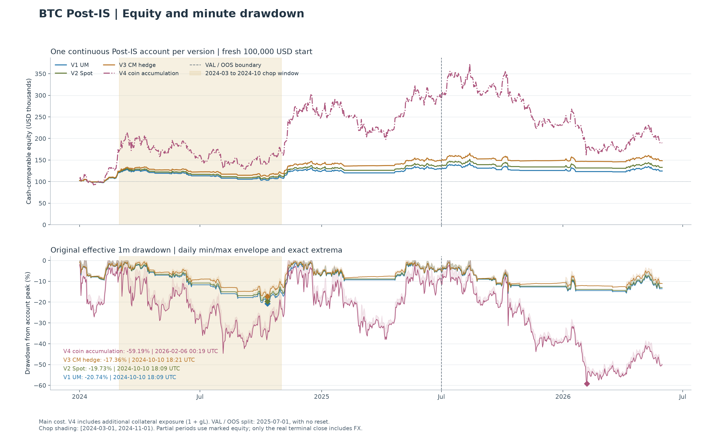
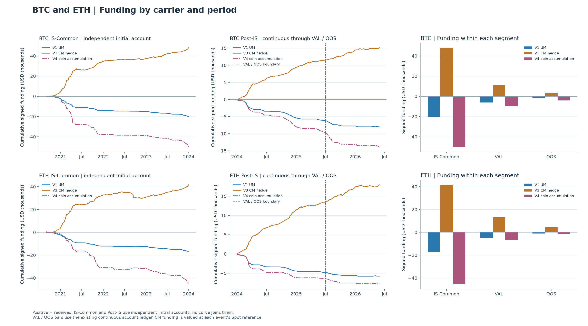
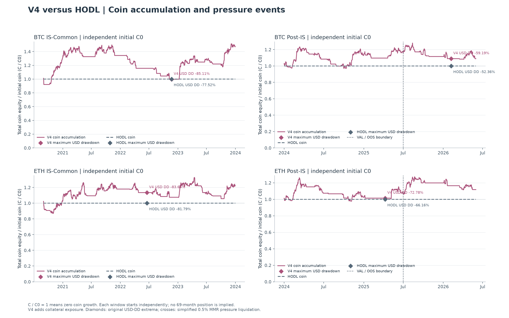
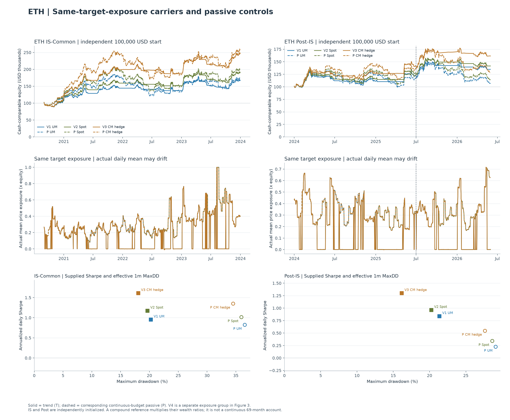

# R5 跨载体 CP3：BTC 样本外与 ETH 终局报告

**用户授权一次性描述性评估（原 R5 未过 IS V3/V5）**。本阶段零调参、无自动晋级；本报告仅整理已完成的一次性账户与检验输出。

V3 币本位套保在 BTC、ETH Post-IS 的现金收益与回撤指标均优于同一趋势信号的 U 本位和现货；资金费收入是已观察载体差异的重要组成。趋势开关相对同预算持续多头的日均超额检验仍未显著。V4 两个资产均净赚币，但 BTC/ETH Post-IS 美元最大回撤分别达 59.19%/72.78%，ETH 现金收益仍为负。87 个账户均无简化压力强平事件。

## 1. 授权、提交与执行边界

| 项目 | 登记值 |
| --- | --- |
| CP2 基线 | f0c21acdd9320d87272d3c8cd46fe95b8d72ec5d |
| CP3 实现与数据登记提交 | 4d3d103e6614e98de1bdf15cb17a8619d4e74ad7 |
| 独立 POST 单行解锁提交 | 05fe6f1a46dbd99fad92b07dba973ac7c44f19ab |
| 实现清单 SHA256 | 2eef099e0035600172fc5d3a540cabc34b6c3679fc5a4c682dbe342637dd327f |
| 输入清单 SHA256 | 68866ee3c47a03c65f5799b8e581337834fe994d30819427455e9f4eb36760d0 |
| 干净起点 | 解锁提交；git status --porcelain 完全为空 |
| 正式运行（UTC） | 2026-11-08T11:51:06.736899+00:00 → 2026-11-08T14:54:09.503605+00:00 |
| 正式结果 | 87/87 账户、21/21 配对统计家族、4/4 图；退出码 0；无自动重试 |
| 锁状态 | BTC_IS_UNLOCKED=True；POST_IS_AND_ETH_UNLOCKED=True |

Post-IS 统一为 [2024-01-01, 2026-06-01)，882 天/29 个完整自然月。VAL 为 [2024-01-01, 2025-07-01)，547 天/18 月；OOS 为 [2025-07-01, 2026-06-01)，335 天/11 月。2025-07-01 不清仓、不换币、不重置；首日收益继承 2025-06-30 23:59 权益。完整窗口末端按 2026-05-31 23:59 处理。

BTC Post 主矩阵 24 + 取整 3 + CM 自信号 3；ETH IS-Common 主矩阵 24；ETH Post 主矩阵 24；ETH IS CM 自信号 3 + Post CM 自信号 3 + Post 取整 3，总计 87。BTC IS-Common 仅复用已冻结 CP2 结果，未重跑。

SMA60、20 日波动率、20% 年化目标、1.0x 预算上限、周一预算更新、三档成本、强平/现金规则及种子全数继承。Webb 99,999 次（种子 2026111001），整月配对抽样 10,000 次（种子 2026111002）。1 USDT 按 1 USD；P 是相同事前预算下持续多头，T 是趋势开关账户，实际实现波动不必相同。

## 2. 解锁前验证、数据来源与历史停机归档

固定 Python 3.14.4 / pandas 3.0.5 / NumPy 2.5.4 / PyArrow 26.0.1 / Numba 0.68.1 / SciPy 1.18.1 / Matplotlib 3.11.2 / pytest 9.2.0。完整适用合成验证为 **325 passed、3 deselected**；13 条既知日期定位器警告，不影响通过。生产 SHA256 校验及冻结 testing_guard.py 保持原字节，最新修正仅将新测试夹具改为 synthetic_raw。

精确排除的历史锁断言如下，原因与完整命令见 `cp3_registration/synthetic_validation.json`：

- `tests/test_trend_hold_engine.py::test_rejects_missing_or_invalid_daily_inputs_and_real_context_before_access`

- `tests/test_trend_venue_scope_features.py::test_two_real_locks_and_provenance`

- `tests/test_trend_venue_cp2_runtime.py::test_runtime_rejects_post_is_eth_and_real_locked_before_feature_work`

这些测试要求历史未解锁状态，与已批准 BTC=True 基线冲突；其余锁定覆盖与合成回归全部通过。32 个 CP1 文件（仅规范化获批锁行）、142 个历史保护文件、CP2 登记及 407 个已发布产物均核验不变。

正式运行前实际新卷可用 40.678 GiB，超过 40 GiB 阈值。数据、报告、LFS、缓存与临时目录均落在 `/mnt/ppvp-backtests`，UUID `d60bc8c8-11ef-4540-8d13-e2327feac6a1`。绑定挂载路径已在硬链接前映射至主挂载入口，避免 EXDEV；文件字节与对应关系经 SHA256 核验。

锁定预检复用了 479 个官方 ZIP、99 个已保存 dapi 页，新增网络归档/API 请求均为 0；1,077 个来源/缓存文件完成哈希验证。截止日修订在新行情特征与收益解锁前由输入可核实性决定，未启用 2026-10 REST 补齐或 2026-07～10 资金费替代。全部正式输入止于 2026-06-01 前。

| 资产/载体 | Context 起点 UTC | 分钟数 | bad | archive_gap | 占位分钟 |
| --- | --- | --- | --- | --- | --- |
| BTC/UM | 2023-11-01T00:00:00+00:00 | 1357920 | 126 | 0 | 126 |
| BTC/SPOT | 2023-11-01T00:00:00+00:00 | 1357920 | 0 | 0 | 0 |
| BTC/CM | 2023-11-01T00:00:00+00:00 | 1357920 | 3224 | 0 | 3224 |
| ETH/UM | 2020-07-01T00:00:00+00:00 | 3111840 | 276 | 0 | 276 |
| ETH/SPOT | 2020-07-01T00:00:00+00:00 | 3111840 | 1634 | 1424 | 210 |
| ETH/CM | 2020-08-18T07:01:00+00:00 | 3042299 | 9549 | 0 | 9549 |

BTC 2023-11～12 仅作预热。ETH CM 原生 K 线始于 2020-08-18 07:01，首条真实资金费为 08:00；不存在的 00:00 上线前槽位未补造，实际排除记录数为 0。ETH CM 2023-08-28～31 使用 4 个核验过的官方日包。ETH Spot 十处共 1,424 分钟缺口按已批准规则打标并以前值估值，无整日零有效分钟；保留 2020-12-21 月包多出的 21 条原生记录。

| 资金费来源 | 原生期结算数 | Vision/dapi 重叠 | 精确 Decimal 一致 | 最大差 | 早期补齐 | 月末补齐 | 起点前排除 |
| --- | --- | --- | --- | --- | --- | --- | --- |
| BTC_UM | 2646 | None | None | None | 0 | 0 | 0 |
| BTC_CM | 2646 | 2588 | 2588 | 0E-8 | 0 | 58 | 0 |
| ETH_UM | 6483 | None | None | None | 0 | 0 | 0 |
| ETH_CM | 6338 | 4181 | 4181 | 0E-8 | 2045 | 112 | 0 |

BTC 两个资金费缓存另含 2023-11～12 的 183 个预热点，缓存总数各 2,829；上表原生 Post 期各 2,646 点。ETH UM/CM 缓存分别为 6,483/6,338 点。CM 重叠记录精确一致率均 100%，早期和月末补点逐条登记官方来源。现货无资金费。

| 资产/载体 | 异常开盘分钟 UTC | 原始 close_time UTC | 类型 |
| --- | --- | --- | --- |
| ETH/SPOT | 2020-12-21T14:08:00+00:00 | 2020-12-21T13:47:20.528000+00:00 | negative_close_placeholder |
| ETH/SPOT | 2021-02-11T03:40:00+00:00 | 2021-02-11T03:40:55.829000+00:00 | early_close |
| ETH/SPOT | 2021-04-25T04:00:00+00:00 | 2021-04-25T04:00:59.271000+00:00 | early_close |
| ETH/SPOT | 2021-08-13T01:59:00+00:00 | 2021-08-13T01:59:59+00:00 | early_close |
| ETH/SPOT | 2021-12-24T04:59:00+00:00 | 2021-12-24T04:59:56.158000+00:00 | early_close |
| ETH/SPOT | 2023-03-24T12:39:00+00:00 | 2023-03-24T12:39:43.061000+00:00 | early_close |

共 6 条 close_time 例外；原 OHLCV 零改动、决策时钟始终 open_time+1min，未新增静默 bad 标记。完整缓存文件字节与 content_sha256、缺口区间、原始页与归档逐项哈希见 [输入清单](../../reports/trend_hold_venue_round/cp3_registration/venue_cp3_inputs.json)。

历史停机及纯只读诊断已收录 `cp3_registration/validation_history/`，全部由实现清单绑定。外部原始证据保留在 `/mnt/ppvp-backtests/diagnostics/cp3_availability_20261108/`；ETH 起点说明修订、EXDEV 和测试夹具保护冲突的外部现场分别位于：

- `/mnt/ppvp-backtests/operations/archive/cp3_eth_launch_boundary_stop_20261108_yy2dpm24`

- `/mnt/ppvp-backtests/operations/archive/cp3_hardlink_mount_stop_20261108_x8zx7z80`

- `/mnt/ppvp-backtests/operations/archive/cp3_bindmount_fix_resume_zq9i6eny/raw_attempt_1`

- `/mnt/ppvp-backtests/operations/archive/cp3_synthetic_guard_stop_rq_l_5oq`

| 已归档停机文件（相对 registration） | SHA256 |
| --- | --- |
| validation_history/edit_helper_stop_20261108/STOPPED_unfrozen_edit.json | 4827a4bd35c1be9ce61cc31fb133809d069a5688579a6a4849720fc3fc04ea6e |
| validation_history/eth_launch_boundary_stop_20261108/STOPPED_summary.json | a001ed7c3d3583bd72acd2a4ccaf280b1bd73f1cb886818f14eaed2fd1c72078 |
| validation_history/hardlink_mount_stop_20261108/STOPPED_entrypoint_preparation.json | 3e1eb5299ef24733fcc2540a38e86bd7b7d8950f0ea0f841eb2b81114fe32370 |
| validation_history/hardlink_mount_stop_20261108/STOPPED_summary.json | d1a65aa9ac63a168ba921d1a8447bd24b3357efbd21be8513dbd055ceec622f0 |
| validation_history/hardlink_mount_stop_20261108/STOPPED_venue_cp3_inputs.json | 8ebbe8458f39dde0c50f56ff3613e79b3ba9b600c7dd3c58b0dd3fda0f9115c8 |
| validation_history/pre_revision_20261108/STOPPED_entrypoint_preparation.json | c3ea487e733f4b8ccd9082d548d49637ddb4c07093fa0296ad1f055a4811471f |
| validation_history/pre_revision_20261108/STOPPED_summary.json | 6b3b54c687c69d4b486b7138b63d7b5bf726e7c835ff11780410010db4dc09c7 |
| validation_history/pre_revision_20261108/STOPPED_venue_cp3_inputs.json | 09522df7cc267faf6d8e743efe81bafc38d0c8697f70b6f0d07a81847ae5ad89 |
| validation_history/synthetic_attempt_1_stop/STOPPED_summary.json | 96e12ac468f639ce7273bc6885be8956bb599c0c9d145f8cfa8f4a2118e15d0b |
| validation_history/synthetic_attempt_1_stop/STOPPED_synthetic_validation.json | d18628e90a239d47a518cb5537da7ce1e06618a35da98d2242e091ab3251875c |
| validation_history/synthetic_guard_stop/STOPPED_summary.json | f5663826ba9e01a5c49e8799b3529594511fa1cb2b1981ad3765c7f6b622d19a |
| validation_history/synthetic_guard_stop/STOPPED_synthetic_validation.json | d3ade5c9713175e09adf68804a42d74f32811a25b7533cf2cfc8273b460acb81 |

## 3. 全窗口主配置对照

以下为 main_17、规范 UM 信号、连续合约。IS-Common 为 2020-09～2023-12（BTC 复用 CP2）；Post 为 2024-01～2026-05。收益是现金闭环/连续片段口径，最大回撤取有效 1m 权益；币增长在完整期末换回现金前计量，线性/现货账户不适用记 NA。部分区间不添加假想交易或换币费用。

### BTC

| 窗口 | 版本 | 收益 | 夏普 | 最大回撤 | 资金费 USD | 币增长 |
| --- | --- | --- | --- | --- | --- | --- |
| IS-Common | V1_USDM | 93.21% | 1.188 | 33.69% | -20,432.90 | NA |
| IS-Common | P_USDM | 68.29% | 0.771 | 42.90% | -24,098.48 | NA |
| IS-Common | V2_SPOT | 120.36% | 1.411 | 32.56% | 0.00 | NA |
| IS-Common | P_SPOT | 97.56% | 0.975 | 41.53% | 0.00 | NA |
| IS-Common | V3_CM_DeltaMatched | 184.11% | 1.838 | 30.23% | 48,064.99 | -21.59% |
| IS-Common | P_CM_DeltaMatched | 150.79% | 1.277 | 40.31% | 44,679.61 | -30.79% |
| IS-Common | V4_CM_CoinAccum | 432.97% | 1.036 | 85.11% | -49,949.71 | 47.09% |
| IS-Common | HODL_1x_Coin | 262.35% | 0.922 | 77.52% | 0.00 | 0.00% |
| VAL | V1_USDM | 29.44% | 1.061 | 20.74% | -6,206.54 | NA |
| VAL | P_USDM | 47.08% | 1.213 | 20.25% | -8,068.18 | NA |
| VAL | V2_SPOT | 36.33% | 1.258 | 19.73% | 0.00 | NA |
| VAL | P_SPOT | 56.76% | 1.396 | 19.15% | 0.00 | NA |
| VAL | V3_CM_DeltaMatched | 48.62% | 1.595 | 17.36% | 11,507.29 | -41.29% |
| VAL | P_CM_DeltaMatched | 69.44% | 1.628 | 18.64% | 10,651.16 | -33.07% |
| VAL | V4_CM_CoinAccum | 196.02% | 1.439 | 44.67% | -9,695.48 | 16.93% |
| VAL | HODL_1x_Coin | 153.15% | 1.468 | 33.12% | 0.00 | 0.00% |
| OOS | V1_USDM | -3.80% | -0.200 | 15.86% | -1,825.68 | NA |
| OOS | P_USDM | -17.04% | -0.780 | 30.81% | -3,366.22 | NA |
| OOS | V2_SPOT | -2.49% | -0.104 | 15.25% | 0.00 | NA |
| OOS | P_SPOT | -15.13% | -0.673 | 29.69% | 0.00 | NA |
| OOS | V3_CM_DeltaMatched | -0.14% | 0.066 | 14.70% | 3,602.64 | 45.33% |
| OOS | P_CM_DeltaMatched | -14.00% | -0.611 | 28.92% | 2,245.45 | 25.16% |
| OOS | V4_CM_CoinAccum | -36.02% | -0.673 | 59.19% | -4,130.40 | -6.89% |
| OOS | HODL_1x_Coin | -31.29% | -0.742 | 52.36% | 0.00 | 0.00% |
| Post-IS | V1_USDM | 24.52% | 0.623 | 20.74% | -8,032.22 | NA |
| Post-IS | P_USDM | 22.02% | 0.470 | 30.81% | -11,434.39 | NA |
| Post-IS | V2_SPOT | 32.94% | 0.785 | 19.73% | 0.00 | NA |
| Post-IS | P_SPOT | 33.04% | 0.625 | 29.69% | 0.00 | NA |
| Post-IS | V3_CM_DeltaMatched | 48.41% | 1.061 | 17.36% | 15,109.93 | -14.68% |
| Post-IS | P_CM_DeltaMatched | 45.71% | 0.790 | 28.92% | 12,896.61 | -16.23% |
| Post-IS | V4_CM_CoinAccum | 89.39% | 0.738 | 59.19% | -13,825.88 | 8.88% |
| Post-IS | HODL_1x_Coin | 73.94% | 0.716 | 52.36% | 0.00 | 0.00% |

### ETH

| 窗口 | 版本 | 收益 | 夏普 | 最大回撤 | 资金费 USD | 币增长 |
| --- | --- | --- | --- | --- | --- | --- |
| IS-Common | V1_USDM | 66.91% | 0.955 | 20.22% | -17,182.64 | NA |
| IS-Common | P_USDM | 71.99% | 0.825 | 36.55% | -21,516.43 | NA |
| IS-Common | V2_SPOT | 90.12% | 1.176 | 19.65% | 0.00 | NA |
| IS-Common | P_SPOT | 98.92% | 1.016 | 35.94% | 0.00 | NA |
| IS-Common | V3_CM_DeltaMatched | 146.54% | 1.613 | 18.03% | 41,552.32 | -53.05% |
| IS-Common | P_CM_DeltaMatched | 156.48% | 1.352 | 34.52% | 44,612.66 | -51.16% |
| IS-Common | V4_CM_CoinAccum | 540.98% | 1.062 | 83.65% | -45,158.09 | 22.06% |
| IS-Common | HODL_1x_Coin | 425.13% | 1.013 | 81.79% | 0.00 | 0.00% |
| VAL | V1_USDM | 22.55% | 0.883 | 21.35% | -4,819.39 | NA |
| VAL | P_USDM | 17.45% | 0.561 | 28.04% | -6,733.78 | NA |
| VAL | V2_SPOT | 27.76% | 1.048 | 20.23% | 0.00 | NA |
| VAL | P_SPOT | 24.15% | 0.714 | 25.50% | 0.00 | NA |
| VAL | V3_CM_DeltaMatched | 42.02% | 1.470 | 16.14% | 13,497.67 | 30.51% |
| VAL | P_CM_DeltaMatched | 36.55% | 0.979 | 24.26% | 12,408.53 | 25.49% |
| VAL | V4_CM_CoinAccum | 17.97% | 0.536 | 72.78% | -6,456.52 | 8.42% |
| VAL | HODL_1x_Coin | 8.81% | 0.427 | 66.16% | 0.00 | 0.00% |
| OOS | V1_USDM | 10.05% | 0.764 | 12.22% | -948.03 | NA |
| OOS | P_USDM | -9.38% | -0.363 | 29.10% | -1,446.84 | NA |
| OOS | V2_SPOT | 10.81% | 0.813 | 11.96% | 0.00 | NA |
| OOS | P_SPOT | -8.38% | -0.310 | 28.62% | 0.00 | NA |
| OOS | V3_CM_DeltaMatched | 13.68% | 1.000 | 10.93% | 4,420.04 | 40.88% |
| OOS | P_CM_DeltaMatched | -6.43% | -0.210 | 27.62% | 3,337.40 | 15.95% |
| OOS | V4_CM_CoinAccum | -16.82% | 0.123 | 67.82% | -1,326.80 | 3.08% |
| OOS | HODL_1x_Coin | -19.31% | -0.012 | 64.64% | 0.00 | 0.00% |
| Post-IS | V1_USDM | 34.87% | 0.840 | 21.35% | -5,767.42 | NA |
| Post-IS | P_USDM | 6.43% | 0.227 | 29.10% | -8,180.62 | NA |
| Post-IS | V2_SPOT | 41.57% | 0.964 | 20.23% | 0.00 | NA |
| Post-IS | P_SPOT | 13.74% | 0.343 | 28.62% | 0.00 | NA |
| Post-IS | V3_CM_DeltaMatched | 61.44% | 1.302 | 16.14% | 17,917.72 | 83.86% |
| Post-IS | P_CM_DeltaMatched | 27.77% | 0.547 | 27.62% | 15,745.93 | 45.51% |
| Post-IS | V4_CM_CoinAccum | -1.87% | 0.385 | 72.78% | -7,783.32 | 11.76% |
| Post-IS | HODL_1x_Coin | -12.19% | 0.265 | 66.16% | 0.00 | 0.00% |

来源：[period_metrics.csv](../../reports/trend_hold_venue_round/cp3_post_is_and_eth/period_metrics.csv)、[comparison.csv](../../reports/trend_hold_venue_round/cp3_post_is_and_eth/comparison.csv)。完整 CAGR、实现波动率、Sortino、订单和各账户台账均保留在原始导出中。

BTC Post：V1/V2/V3 收益 24.52%/32.94%/48.41%，对应 P 为 22.02%/33.04%/45.71%；T 在 VAL 均落后 P，OOS 均少亏。ETH Post：T 分别 34.87%/41.57%/61.44%，P 为 6.43%/13.74%/27.77%；OOS 的 T 为正收益而 P 为负。两资产的 T 均降低了观测回撤，但这些结果不等于日均超额具有统计显著性。

## 4. 配对统计、门禁与诚实披露

T 检验趋势账户日均收益，D 检验日均 T−P；受约束 Webb 99,999 次、整月配对重抽样 10,000 次。Holm 仅每个载体/窗口内 T、D 两个假设，显著性 0.05；未对 21 个家族做全局校正，也不构成自动晋级。下表日均与区间单位为 bp/日。

| 家族 | T均值 | D均值 | T raw p | T Holm p | D raw p | D Holm p | D 95%月块区间 |
| --- | --- | --- | --- | --- | --- | --- | --- |
| BTC__Post-IS__UM | 2.87 | -0.12 | 0.22171 | 0.44342 | 0.52127 | 0.52127 | [-4.00, 4.32] |
| BTC__Post-IS__SPOT | 3.61 | -0.36 | 0.17078 | 0.34156 | 0.56481 | 0.56481 | [-4.21, 4.06] |
| BTC__Post-IS__CM_DeltaMatched | 4.86 | -0.14 | 0.09957 | 0.19914 | 0.52444 | 0.52444 | [-4.03, 4.31] |
| BTC__VAL__UM | 5.14 | -2.66 | 0.18918 | 0.37836 | 0.86054 | 0.86054 | [-6.50, 2.31] |
| BTC__VAL__SPOT | 6.09 | -2.88 | 0.15215 | 0.30430 | 0.88291 | 0.88291 | [-6.68, 2.03] |
| BTC__VAL__CM_DeltaMatched | 7.66 | -2.72 | 0.09692 | 0.19384 | 0.86459 | 0.86459 | [-6.57, 2.28] |
| BTC__OOS__UM | -0.84 | 4.03 | 0.61176 | 0.61176 | 0.17989 | 0.35978 | [-3.00, 12.20] |
| BTC__OOS__SPOT | -0.43 | 3.76 | 0.55758 | 0.55758 | 0.19468 | 0.38936 | [-3.24, 11.88] |
| BTC__OOS__CM_DeltaMatched | 0.28 | 4.07 | 0.46078 | 0.46078 | 0.17515 | 0.35030 | [-2.92, 12.23] |
| ETH__IS-Common__UM | 4.64 | -0.54 | 0.05022 | 0.10044 | 0.59296 | 0.59296 | [-4.70, 3.88] |
| ETH__IS-Common__SPOT | 5.71 | -0.66 | 0.02614 | 0.05228 | 0.61459 | 0.61459 | [-4.81, 3.75] |
| ETH__IS-Common__CM_DeltaMatched | 7.85 | -0.61 | 0.00826 | 0.01652 | 0.60519 | 0.60519 | [-4.79, 3.83] |
| ETH__Post-IS__UM | 3.75 | 2.28 | 0.15800 | 0.31600 | 0.20694 | 0.31600 | [-2.90, 7.84] |
| ETH__Post-IS__SPOT | 4.30 | 2.08 | 0.12825 | 0.25650 | 0.22789 | 0.25650 | [-3.09, 7.64] |
| ETH__Post-IS__CM_DeltaMatched | 5.79 | 2.25 | 0.06389 | 0.12778 | 0.20888 | 0.20888 | [-2.90, 7.82] |
| ETH__VAL__UM | 4.11 | 0.36 | 0.22668 | 0.45336 | 0.46085 | 0.46085 | [-6.02, 7.85] |
| ETH__VAL__SPOT | 4.87 | 0.11 | 0.18990 | 0.37980 | 0.48672 | 0.48672 | [-6.29, 7.59] |
| ETH__VAL__CM_DeltaMatched | 6.80 | 0.31 | 0.11216 | 0.22432 | 0.46637 | 0.46637 | [-6.06, 7.80] |
| ETH__OOS__UM | 3.17 | 5.42 | 0.28271 | 0.28271 | 0.10913 | 0.21826 | [-2.18, 13.17] |
| ETH__OOS__SPOT | 3.38 | 5.29 | 0.27344 | 0.27344 | 0.11227 | 0.22454 | [-2.25, 13.00] |
| ETH__OOS__CM_DeltaMatched | 4.14 | 5.43 | 0.23530 | 0.23530 | 0.10730 | 0.21460 | [-2.11, 13.15] |

| ETH IS 家族 | V1 | V2 | V3 | V4 | V5 | V6 |
| --- | --- | --- | --- | --- | --- | --- |
| ETH__IS-Common__UM | True | False | False | False | False | False |
| ETH__IS-Common__SPOT | True | False | False | False | False | False |
| ETH__IS-Common__CM_DeltaMatched | True | True | False | False | False | False |

所有 Post/VAL/OOS 的 V1–V6 均为 **NA**，不沿用虚构的 2022 年切分。ETH IS 的 V1 样本/状态覆盖均通过；UM、Spot 的 V2–V6 未过，CM 仅 V1、V2 通过。三个 ETH IS 的 D 均值均为负，因而不能把未通过主要归因于状态覆盖不足。

BTC、ETH 全部 Post/VAL/OOS 家族的 T、D 在家族内 Holm 后均未拒绝原假设。BTC 全 Post 的 D 甚至略负，尽管部分 T 的复利终值更高：复利与算术日均差不是同一估计量。ETH Post D 为正但区间跨零。只有 29 个 Post 月、11 个 OOS 月，区间仍较宽；月间依赖与此前 IS 选择进一步限制推断。

唯一登记的区间/p 不一致为 **ETH IS-Common SPOT 的 T**：95%日均区间 [0.36435, 11.54521] bp 为正，但 Holm p=0.05228 不拒绝，严格保留原判定。21 个家族均未触发已冻结 MC 边界敏感标记，不能把该 0.05228 另称为已登记的 MC 敏感。所有完整检验、区间、门禁、种子和矩阵哈希见 `statistics/`；未因结果调整抽样。

## 5. 载体、资金费及 2024 年 3–10 月震荡

BTC Post V3 收资金费 15,109.93 USD，V1 付 8,032.22 USD；ETH 分别为收 17,917.72 USD、付 5,767.42 USD，现货均为零。P_CM 也享有套保资金费，因此载体的收息优势并非趋势开关独有。V3 在两个资产的观测现金收益/回撤占优，但不能据此宣称对未来市场的“碾压”或确定性优势。

| 资产 | 基准→比较 | 终值差 | 资金费差 | 手续费PnL差 | 滑点差 | 换币差 | 端点基差 | 价格/路径残差 |
| --- | --- | --- | --- | --- | --- | --- | --- | --- |
| BTC | V1_USDM→V2_SPOT | 8,423.74 | 8,032.22 | -79.32 | -55.43 | 0.00 | 0.00 | 526.28 |
| BTC | V1_USDM→V3_CM_DeltaMatched | 23,888.82 | 23,142.15 | -285.04 | -204.80 | -203.87 | 269.69 | 1,170.68 |
| BTC | P_USDM→P_SPOT | 11,016.47 | 11,434.39 | -45.26 | -31.73 | 0.00 | 0.00 | -340.93 |
| BTC | P_USDM→P_CM_DeltaMatched | 23,692.96 | 24,331.01 | -59.87 | -47.14 | -201.98 | 264.80 | -593.85 |
| ETH | V1_USDM→V2_SPOT | 6,696.87 | 5,767.42 | -42.01 | -29.25 | 0.00 | 0.00 | 1,000.71 |
| ETH | V1_USDM→V3_CM_DeltaMatched | 26,567.38 | 23,685.14 | -244.44 | -177.48 | -213.00 | 244.70 | 3,272.45 |
| ETH | P_USDM→P_SPOT | 7,308.07 | 8,180.62 | -24.77 | -17.46 | 0.00 | 0.00 | -830.33 |
| ETH | P_USDM→P_CM_DeltaMatched | 21,334.22 | 23,926.55 | -62.36 | -46.02 | -189.41 | 193.66 | -2,488.20 |

差额表来源为 `crossvenue.csv` 的既有桥接；资金费按发生时现货价折算，后续存量币价格变化计入动态持币项。资金费、复利、再套保与基差路径互相作用，上表不是关闭资金费后的独立反事实。

| 资产 | 版本 | 区间收益 | 最大回撤 | 切换/订单 | 资金费USD | 负段价格损失USD | 实际摩擦USD | 资金费覆盖率 |
| --- | --- | --- | --- | --- | --- | --- | --- | --- |
| BTC | V1_USDM | -8.84% | 20.74% | 18/38 | -2,819.15 | 18,023.37 | 871.29 | -14.92% |
| BTC | V2_SPOT | -6.68% | 19.73% | 18/38 | 0.00 | 18,541.19 | 894.70 | 0.00% |
| BTC | V3_CM_DeltaMatched | -2.09% | 17.36% | 18/52 | 6,216.97 | 19,809.31 | 936.06 | 29.97% |
| BTC | V4_CM_CoinAccum | 1.06% | 44.67% | 18/38 | -4,192.71 | 79,406.10 | 1,318.70 | -5.19% |
| ETH | V1_USDM | -13.02% | 21.35% | 14/28 | -2,592.51 | 14,659.01 | 655.16 | -16.93% |
| ETH | V2_SPOT | -11.08% | 20.23% | 14/28 | 0.00 | 15,027.89 | 673.03 | 0.00% |
| ETH | V3_CM_DeltaMatched | -5.74% | 16.14% | 14/48 | 7,339.69 | 16,116.17 | 713.63 | 43.61% |
| ETH | V4_CM_CoinAccum | -36.42% | 55.89% | 14/28 | -4,005.58 | 102,955.86 | 901.23 | -3.86% |

区间严格为 [2024-03-01, 2024-11-01)，继承 2 月 29 日估值。BTC 18 次开关/19 段，ETH 14 次/15 段；切换不等于成交次数。V3 资金费分别覆盖已观察“负价格归因状态段损失+实际摩擦”的 **29.97% / 43.61%**，但区间收益仍为 **−2.09% / −5.74%**。这不是“抵消真实止损比例”，也不是 ETF 对资金费的因果检验；没有附加一个关闭资金费的反事实账户。

### V4 币增长、估值与风险

| 资产/窗口 | 版本 | 初币 | 末币 | 币增长 | 现金终值USD | CM估值USD | Spot估值/FX前USD |
| --- | --- | --- | --- | --- | --- | --- | --- |
| BTC/Post-IS | V3_CM_DeltaMatched | 2.36262102 | 2.01580210 | -14.68% | 148,409.05 | 148,243.30 | 148,512.99 |
| BTC/Post-IS | V4_CM_CoinAccum | 2.36262102 | 2.57249382 | 8.88% | 189,394.26 | 189,182.74 | 189,526.91 |
| BTC/Post-IS | HODL_1x_Coin | 2.36262102 | 2.36262102 | 0.00% | 173,942.83 | 173,748.57 | 174,064.66 |
| ETH/IS-Common | V3_CM_DeltaMatched | 230.29062921 | 108.11699824 | -53.05% | 246,536.26 | 246,854.89 | 246,708.93 |
| ETH/IS-Common | V4_CM_CoinAccum | 230.29062921 | 281.09995262 | 22.06% | 640,984.61 | 641,813.03 | 641,433.55 |
| ETH/IS-Common | HODL_1x_Coin | 230.29062921 | 230.29062921 | 0.00% | 525,125.49 | 525,804.17 | 525,493.28 |
| ETH/Post-IS | V3_CM_DeltaMatched | 43.77991514 | 80.49455655 | 83.86% | 161,440.31 | 161,308.68 | 161,553.38 |
| ETH/Post-IS | V4_CM_CoinAccum | 43.77991514 | 48.92819415 | 11.76% | 98,130.65 | 98,050.63 | 98,199.37 |
| ETH/Post-IS | HODL_1x_Coin | 43.77991514 | 43.77991514 | 0.00% | 87,805.23 | 87,733.64 | 87,866.73 |

BTC/ETH Post V4 币增长 **8.8830%/11.7595%**；BTC OOS 缩币 6.8856%，ETH OOS 继续增币 3.0843%。V4 Post 美元收益为 89.39%/−1.87%，最大回撤 59.19%/72.78%。没有强平并不等于低风险：V4 额外抵押币敞口约为 1+gL，不能与 V1/V2/V3 作同风险优胜排名。0.5% MMR 与合约 OHLC 只是已冻结的简化压力代理。

## 6. 成本、69 月参考与执行诊断

**gross_0 同时关闭手续费、滑点和资金费**。因此 gross→main 差额不能全称交易摩擦侵蚀；V3 在 main 下高于 gross 主要应结合净收资金费解释。main→harsh 保留相应资金费规则并提高交易摩擦。

| BTC Post版本 | gross收益 | main收益 | harsh收益 |
| --- | --- | --- | --- |
| V1_USDM | 36.35% | 24.52% | 21.43% |
| V2_SPOT | 36.32% | 32.94% | 29.65% |
| V3_CM_DeltaMatched | 36.07% | 48.41% | 44.37% |
| V4_CM_CoinAccum | 107.48% | 89.39% | 84.20% |

| ETH Post版本 | gross收益 | main收益 | harsh收益 |
| --- | --- | --- | --- |
| V1_USDM | 43.93% | 34.87% | 32.57% |
| V2_SPOT | 44.02% | 41.57% | 39.16% |
| V3_CM_DeltaMatched | 43.98% | 61.44% | 58.24% |
| V4_CM_CoinAccum | 4.78% | -1.87% | -3.77% |

| 资产 | 版本 | IS-Common收益 | Post收益 | 69月双独立期连乘参考收益 |
| --- | --- | --- | --- | --- |
| ETH | V1_USDM | 66.91% | 34.87% | 125.11% |
| ETH | P_USDM | 71.99% | 6.43% | 83.05% |
| ETH | V2_SPOT | 90.12% | 41.57% | 169.15% |
| ETH | P_SPOT | 98.92% | 13.74% | 126.25% |
| ETH | V3_CM_DeltaMatched | 146.54% | 61.44% | 298.01% |
| ETH | P_CM_DeltaMatched | 156.48% | 27.77% | 227.69% |
| ETH | V4_CM_CoinAccum | 540.98% | -1.87% | 529.00% |
| ETH | HODL_1x_Coin | 425.13% | -12.19% | 361.09% |
| BTC | V1_USDM | 93.21% | 24.52% | 140.59% |
| BTC | P_USDM | 68.29% | 22.02% | 105.35% |
| BTC | V2_SPOT | 120.36% | 32.94% | 192.96% |
| BTC | P_SPOT | 97.56% | 33.04% | 162.82% |
| BTC | V3_CM_DeltaMatched | 184.11% | 48.41% | 321.65% |
| BTC | P_CM_DeltaMatched | 150.79% | 45.71% | 265.44% |
| BTC | V4_CM_CoinAccum | 432.97% | 89.39% | 909.41% |
| BTC | HODL_1x_Coin | 262.35% | 73.94% | 530.28% |

69 个月覆盖 2020-09～2026-05，公式仅为 `(1+R_IS-Common)*(1+R_Post)-1`；两段各自独立初始化，**不是单一 69 个月连续仓位或连续净值**，未构造跨初始化边界的连续夏普或回撤。

CM 自信号 BTC Post-IS：882 天，开关一致率 100.000000%；预算差均值 -0.00292558、最大绝对差 0.01630318。

CM 自信号 ETH IS-CM-SelfSignal：1156 天，开关一致率 99.740484%；预算差均值 -0.00060010、最大绝对差 0.01570180。

CM 自信号 ETH Post-IS：882 天，开关一致率 99.886621%；预算差均值 -0.00102838、最大绝对差 0.00732557。

BTC Post 自信号 V3/P/V4 终值差分别 −169.99/+58.09/−47.77 USD；ETH Post 为 −2,690.96/−138.55/−1,637.26 USD。ETH IS CM 自信号从 2020-11-01 独立起步，不与 9 月起点账户伪作同初始状态差。

| 资产 | 版本 | USD/张 | 取整终值−连续终值USD | 币增长差 |
| --- | --- | --- | --- | --- |
| BTC | V3_CM_DeltaMatched | 100.0 | 0.012573% |
| BTC | P_CM_DeltaMatched | 100.0 | 0.010864% |
| BTC | V4_CM_CoinAccum | 100.0 | -0.003937% |
| ETH | V3_CM_DeltaMatched | 10.0 | -0.006382% |
| ETH | P_CM_DeltaMatched | 10.0 | 0.004480% |
| ETH | V4_CM_CoinAccum | 10.0 | -0.002751% |

| 资产/窗口 | 现货版本 | 现金裁剪次数 | 聚合数量裁剪比例 |
| --- | --- | --- | --- |
| BTC/Post-IS | V2_SPOT | 0.000903% |
| BTC/Post-IS | P_SPOT | 0.002497% |
| ETH/IS-Common | V2_SPOT | 0.005473% |
| ETH/IS-Common | P_SPOT | 0.008109% |
| ETH/Post-IS | V2_SPOT | 0.000000% |
| ETH/Post-IS | P_SPOT | 0.000000% |

87 个不同配置账户合计现金裁剪 10 次（同一历史时点在不同配置中可重复计数），单账户最多 1 次。单次最大现金裁剪幅度未单独导出；上表聚合比例不冒充最大单次幅度，逐笔订单账本保留供审查。所有资金费与价格估值代理、成本、预算和下单参考时点仍按原冻结规则。

## 7. 精确归因与四张图

| 误差字段 | 87账户最大绝对值 |
| --- | --- |
| account_reconciliation_error | 4.07453626394e-10 |
| cm_account_reconciliation_error | 8.06783824988e-26 |
| coin_reconciliation_error | 2.63775365183e-29 |
| max_wallet_reconciliation_error | 1.27256923209e-13 |

原始导出逐日归因误差最大绝对值 **2.118924461e-10 USD**；美元账户最大闭合误差 **4.0745363e-10 USD**，低于冻结的 1e-9；动态持币价格项、合约盯市、资金费、交易/换币摩擦及已登记零下界调整均保留。87 个账户全部 liquidated=False，无压力事件，因此没有需要列出的触线分钟或残币事件。逐日、币口径、CM/Spot 估值核对均见 `reconciliation.csv` 与各账户 `accounting_daily.csv.gz`。

### 图 1：BTC 现金权益与有效1m回撤

V3 在本窗口有较低观测回撤；V4 额外持币敞口令美元曲线与回撤显著放大。VAL/OOS 连续，阴影标出指定震荡段。

### 图 2：BTC/ETH 分载体资金费

V1、V4 总体付费，V3 净收；IS 与 Post 独立展示，Post 曲线跨切分连续。

### 图 3：V4 与 HODL 币数增长

两资产 Post V4 均增币，但币数增长不代表低美元回撤；标记为原始最大美元回撤时刻，未发生压力强平。

### 图 4：ETH 同目标敞口载体与 P 对照

Post T 的收益与回撤指标优于 P，IS T 的总收益落后 P；日均超额检验仍未显著。

图1的回撤阴影为原始有效分钟回撤的每日 min/max 包络，并标出精确最差分钟，不是日收盘回撤。四张图已逐张检查，完整计算口径见 `figure_captions.md`。

## 8. 交付与停止

所有正式原始产出保留，结果目录为 `reports/trend_hold_venue_round/cp3_post_is_and_eth/`。最终 `delivery_hashes.json` 绑定完整物化字节及大小（含本阶段报告、图、执行证据与局部 .gitattributes），排除清单自身；分钟账本和逐步归因通过 Git LFS 交付。报告只登记前两个提交 SHA，不写自身结果提交 SHA。

本轮结束于用户授权的 CP3 描述性终局。没有参数筛选、没有新增统计族、没有缩减抽样、没有自动晋级或继续验证任务。

### LFS 发布核验

174 个唯一 LFS 对象已获服务器验证，零重试、零重定向；物化原文件与 LFS 对象在新卷共享硬链接。发布证据见结果目录 `delivery_validation/lfs_publish_complete.json`、`publication_receipt.json` 和分批日志。Git 结果提交及远端一致性在交付回复中报告，本文不写入自引用提交 SHA。
