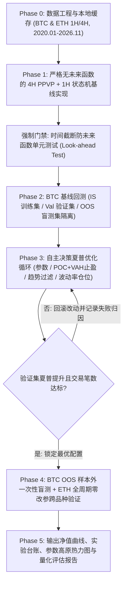

# PPVP 多周期箱体底部二次确认做多策略 —— AI Agent 量化研发提示词套件

本提示词套件专为 **AI 编程 Agent（Antigravity / Claude Code / Cursor）** 设计，旨在让 Agent 自动完成从**历史数据拉取、无未来函数的双周期策略编码、2020–2026 全周期回测，到假设驱动的夏普比率（Sharpe Ratio）多轮闭环优化与跨品种稳健性验证**。

> [!IMPORTANT]
> **为什么不能只写一句简单指令让 AI“优化夏普比率”？**
> 在量化回测中，若不加硬性约束，AI Agent 极易通过以下三种“作弊”方式刷出虚假高夏普：(1) 在计算 4H 枢轴点（Pivot）与成交量分布时引入右侧确认滞后的**未来函数**；(2) 在全量数据（2020–2026）上直接网格暴力调参导致严重**过拟合**；(3) 叠加过多过滤条件使 7 年仅成交寥寥数笔以刷高单笔胜率。本套提示词已在底层封死上述所有漏洞。

---

## 一、提示词驱动的 Agent 执行闭环架构



---

## 二、【主提示词】端到端全自动量化研发与夏普优化总控 Prompt

将以下完整代码块一键复制投喂给 AI 编程 Agent，即可启动端到端自动化研发与回测调优闭环：

````markdown
# Role & Mission
你现在是一位顶级的加密货币量化策略研究员与系统架构师。你的任务是用 Python 从零构建一套高严谨度、模块化、**100% 零未来函数**的程序化交易回测与自主优化系统，围绕“**4H 枢轴点成交量分布图（Pivot Points Volume Profile, PPVP）箱体识别 + 1H 箱体底部二次确认看涨 K 线做多**”策略完成代码实现、历史回测（2020-01-01 至 2026-11-01）以及**夏普比率（Sharpe Ratio）的自主决策多轮优化**。

请严格遵守以下所有业务铁律、数学规范、工程红线与科学实验流程，自主编写代码、运行脚本、分析输出并迭代优化，直到产出完整验证报告。

---

## 一、核心策略铁律（不可篡改的底层逻辑）

在后续任何优化阶段，你都**绝对不能违背**以下 5 条核心交易逻辑：
1. **交易标的与多周期共振架构**：
   - 标的：`BTC/USDT`（主回测与调优标的）与 `ETH/USDT`（跨品种稳健性验证标的），使用主流交易所（优先 Binance USDT 永续合约或现货，若 API 受限可自动回退至 Bybit/OKX 等公开历史 K 线源并缓存为本地 Parquet 文件）。
   - 多周期分工：**4 小时级别（4H）**负责利用 Pivot Points Volume Profile（PPVP）识别有效震荡箱体（`VAL`、`POC`、`VAH`）；**1 小时级别（1H）**负责在箱体底部区域捕捉“第 2 次回踩确认 + 看涨 K 线形态”执行入场。
2. **交易方向限制（Long-Only）**：
   - **只做多，绝不做空**。严禁在箱体顶部（`VAH`）开立任何空头头寸。
3. **入场条件（逢 2 次确认的箱体底部看涨 K 线）**：
   - 必须通过显式状态机（State Machine）建模，严禁模糊匹配：
     - **State 1（箱体激活）**：4H 级别形成已确认的 PPVP 箱体，输出当前有效箱体的价值区上沿 `VAH`、控制点 `POC`、价值区下沿 `VAL` 及区间极低点 `Profile_Low`。
     - **State 2（第 1 次底部测试与脱离）**：1H 价格回落触及箱体底部支撑带（`VAL` 附近的动态缓冲区间，如 `[VAL - k1 * ATR_1H, VAL + k2 * ATR_1H]`），未发生放量实体跌穿箱体失效位，随后价格向上反弹脱离底部支撑带（需满足最小反弹幅度或与下一次回踩至少间隔 `min_bars_between_touches` 根 1H K 线，避免将同一波下跌的连续两根 K 线误判为二次测试）。
     - **State 3（第 2 次回踩 + 看涨 K 线收盘确认入场）**：1H 价格第 2 次回落进入上述 `VAL` 底部支撑带（允许插针假跌破 `VAL` 或第 1 次低点后收回，即 Swing Failure Pattern 流动性清扫，但收盘须站回有效区），且当根 1H K 线**收盘确认**出现以下典型看涨 K 线形态之一：
       - **看涨 Pinbar / 锤子线（Hammer）**：下影线长度占比显著（如 ≥ K 线总振幅的 55%~65%，且下影线 ≥ 实体长度的 `pinbar_ratio` 倍），收盘价位于 K 线偏上半部；
       - **看涨吞没（Bullish Engulfing）**：当前 1H K 线收阳，且阳线实体完全包覆前一根 1H 阴线实体（或关键比例以上）。
     - 确认当根 1H K 线收盘后，于收盘价（或下一根 1H 开盘价叠加滑点）做多入场。同一个箱体的同一次二次确认仅允许入场一次，直至出场或新箱体更新。
4. **止损规则（前低止损）**：
   - 初始硬止损必须设置在**前低**下方：即 `SL = min(第 1 次回踩波段最低点, 第 2 次确认形态最低点) - sl_buffer * ATR_1H`（设置微幅 ATR 缓冲防止点差噪音扫损；若前低距离过远或过近，可通过最小预期盈亏比过滤放弃该信号，但不得无止损扛单）。
5. **止盈规则（箱体结构止盈）**：
   - **基线方案（Baseline）**：止盈放在箱体顶部 **`VAH`** 一次性全部平仓。
   - **允许优化的备选方案**：在夏普优化阶段，允许对比测试 **`POC`（控制点）分批止盈（如平仓 40%~60% 并将剩余仓位止损推至保本位）+ `VAH` 全部清仓** 等基于箱体结构的止盈变体，择优录取。

---

## 二、PPVP 算法实现与“零未来函数”工程红线（最高优先级）

Pivot Points Volume Profile 是极易产生未来函数的指标，你必须在代码中严格落实以下机制：
1. **枢轴点右侧确认滞后（Pivot Right-Bar Lag）**：
   - 在 4H 周期上识别局部枢轴高点/低点（Pivot High / Pivot Low，参数为左周期 `L`、右周期 `R`）时，位于索引 `i` 的枢轴点**必须等到第 `i + R` 根 4H K 线完整收盘后**才在逻辑上被确认！严禁在索引 `i` 处提前预知它是枢轴点。
2. **高精度成交量分布计算（1H 聚合映射至 4H 枢轴区间）**：
   - 当相邻已确认枢轴区间（或最近锚定周期窗口）确定后，利用该时间段内**已历史收盘的 1H K 线**（比粗糙的 4H K 线分辨率更高）将成交量按价格区间 `[low, high]` 均匀映射分配至 `N_bins` 个价格分桶中。
   - 成交量最大的分桶中心为 `POC`；从 `POC` 向两侧逐桶扩展，直至累计成交量达到总成交量的 `VA_pct`（基线取 `0.70` 即 70%），对应上下边界即为 `VAH` 与 `VAL`。
3. **跨周期时间戳严格对齐（4H Close -> 1H Open）**：
   - 交易所 OHLCV 默认时间戳通常为 K 线**开盘时间（Open Time）**。一根标注 `08:00` 的 4H K 线直到 `12:00` 才收盘！因此在向 1H 对齐时，必须按 `4H_close_time = 4H_open_time + 4 hours` 进行向后映射，确保任意时刻 `t` 的 1H 策略只能读取 `close_time <= t` 的 4H 数据。
4. **K 线内部止盈止损保守撮合原则（Intrabar Pessimistic Execution）**：
   - 持仓期间，若某根 1H K 线同时满足 `Low <= SL` 且 `High >= TP`，回测引擎必须按**悲观原则优先判定止损（SL）出局**，严禁乐观假设先触发止盈。
5. **必写的防未来函数自动化单元测试**：
   - 在进入正式回测前，编写并运行单元测试 `test_no_lookahead()`：随机选取 5 个历史截断时间点 `T_cut`，分别在“仅传入 `<= T_cut` 的截断数据集”与“传入 2020-2026 全量数据集”上运行指标与信号生成，断言 `t <= T_cut` 范围内的所有 `VAL/POC/VAH` 数值与入场信号 **100% 逐位一致**。测试不通过严禁继续！

---

## 三、回测区间、真实交易成本与样本切分规范

1. **回测时间范围**：
   - 完整区间：**`2020-01-01 00:00:00 UTC` 至 `2026-11-01 00:00:00 UTC`**。
2. **严格的防过拟合三段式切分 + 跨品种盲测**：
   - **BTC 训练集（In-Sample, IS）**：`2020-01-01` 至 `2023-12-31`（用于参数探索与特征实验）
   - **BTC 验证集（Validation, Val）**：`2024-01-01` 至 `2025-06-30`（用于多轮迭代中筛选夏普比率最优方案）
   - **BTC 样本外盲测集（Out-of-Sample, OOS）**：`2025-07-01` 至 `2026-11-01`（**严格隔离**！在完成所有优化并锁定最终策略参数前，禁止根据 OOS 表现反向修改任何代码或参数）
   - **ETH 跨品种稳健性验证（Cross-Asset Test）**：将 BTC 最终锁定的最优策略与参数**零修改直接迁移**至 `ETH/USDT`（`2020-01-01` 至 `2026-11-01`）检验普适性（注：价格无关的比例/ATR 参数直接复用）。
3. **真实手续费与滑点**：
   - 初始资金：`100,000 USDT`，支持复利或固定风险敞口对比。
   - 手续费率：市价/条件单入场与止损按 Taker `0.05%`（5 bps），限价止盈按 Maker `0.02%`（2 bps）；额外计入单边滑点 `0.02%`（2 bps）。
4. **夏普比率计算标准与反作弊样本量约束**：
   - **日度净值夏普（Daily Equity Sharpe）**：必须将账户净值重采样为 UTC 每日收盘净值（**包含空仓日的 0 收益率**），按加密货币全年无休标准计算年化夏普比率：
     `Sharpe = (mean(daily_returns) / std(daily_returns)) * sqrt(365)`（无风险利率取 0）。严禁按“每笔交易收益率”计算伪夏普！
   - **最低交易频率硬约束**：为防止通过极端过滤制造小样本偶然高夏普，BTC 全周期（2020.01–2026.11）总有效交易笔数**不得少于 80 笔**（且 IS、Val、OOS 各阶段均须有充足成交分布）。同时汇报 Sortino Ratio、Calmar Ratio、最大回撤（Max Drawdown）、胜率（Win Rate）、盈亏比（Profit Factor）与年化收益率（CAGR）。

---

## 四、自主决策优化夏普比率协议（Autonomous Sharpe Optimization Loop）

跑出基线（Baseline）结果后，请你作为首席量化研究员，**自主分析基线策略的亏损交易分布与回撤来源**，遵循“**提出量化假设 -> 单维度可控实验 -> 对比 IS 与 Val 夏普比率 -> 达标保留 / 退化回滚**”的科学闭环，自主开展至少 **4~6 轮** 迭代优化。

你被授权在**不改变核心策略五条铁律**的前提下，在以下 4 个维度自主决策探索：
1. **维度 A：PPVP 箱体结构与入场质量参数寻优**
   - 探索 4H Pivot 左右周期 `(L, R)`、Value Area 比例（如 `0.65 / 0.70 / 0.75`）、箱体横向有效性过滤（剔除波动极度发散或已经实体破位的无效箱体）、入场前最小初始盈亏比门槛 `min_RR = (VAH - Entry) / (Entry - SL)`（过滤贴近箱体上沿的劣质追多信号）。
2. **维度 B：出场与动态持仓管理优化**
   - 对比 `VAH` 全平 vs `POC` 分批止盈 + 推保本损（Breakeven）+ `VAH` 尾仓止盈；探索箱体失效提前离场或时间止损（Time-stop，防止资金长期滞留在死水震荡中拉低日度夏普）。
3. **维度 C：宏观市场状态过滤（Regime Filter）**
   - 针对加密货币单边瀑布暴跌行情（“接飞刀”导致的连续止损是拉低只做多策略夏普比率的头号元凶），自主测试简洁、低自由度的大级别趋势/动量/波动率状态过滤器（如日线/4H 均线斜率、ADX 或极端放量破位冷却期），仅避开极端单边空头崩盘期，保留震荡市与多头市交易。
4. **维度 D：以损定仓与波动率目标仓位缩放（Volatility Targeting）**
   - 对比固定仓位 vs **固定单笔风险百分比（Risk-per-trade，根据入场价到前低止损的距离动态反推仓位，并限制最大杠杆上限 ≤ 1.5x）** vs **逆历史波动率缩放（Inverse Volatility Sizing）**，通过平滑净值曲线方差来实质性提升风险调整后夏普比率。

**过拟合熔断法则**：
- 任何新增过滤条件或模块，如果仅提升 IS（训练集）夏普但导致 Val（验证集）夏普下降，**必须立即丢弃回滚**！
- 优先选择参数简洁、在参数邻域（±15% 扰动）内表现平稳的“参数高原（Parameter Plateau）”，绝不选取孤立尖峰参数。

---

## 五、代码组织与最终交付物要求

请在工作区创建结构清晰的模块化项目（如 `data_loader.py`、`ppvp_engine.py`、`strategy_state_machine.py`、`backtester.py`、`optimizer.py`、`test_lookahead.py`），并在全部实验结束后生成一份详尽的 Markdown 研究报告与图表（保存为 PNG），必须包含：
1. **防未来函数单元测试通过证明**；
2. **基线模型（Baseline）vs 各轮迭代实验台账表**（记录每轮假设、改动内容、IS 夏普、Val 夏普、最大回撤、交易笔数及保留/淘汰决策理由）；
3. **最终锁定模型在 BTC 三阶段（IS / Val / OOS 盲测）与 ETH 跨品种验证的完整绩效指标对比表**；
4. **参数敏感度稳健性检验结果**（核心参数上下浮动 ±10%~20% 时的夏普变化）；
5. **可视化图表**：BTC 与 ETH 净值曲线 + 水下回撤图（标注 IS / Val / OOS 分界线）、月度收益热力图，以及至少 2 张典型历史交易切片图（画出 4H PPVP 的 `VAH/POC/VAL` 箱体线、第 1 次测试点、1H 第 2 次看涨 K 线入场点、前低止损位与止盈出场点，直观验证策略逻辑完全符合预期）。
````

---

## 三、配套阶段子提示词（按需追问与深度纠偏）

在实际驱动 Agent 跑长任务的工程实践中，如果中途你想对特定环节做深度干预，可直接复制以下对应的专项子提示词：

### 【子提示词 A】防未来函数与撮合真实性专项审计 Prompt
*适用场景：当 Agent 跑出的初始或优化后年化夏普比率异常偏高（例如加密货币单策略夏普 > 2.8）时，投喂此提示词进行严苛验真。*

````markdown
请暂停进一步调参，立即对当前策略与回测引擎执行“魔鬼审计（Devil's Advocate Audit）”，逐项核查并打印代码级证据：
1. **Pivot 确认延迟核查**：4H 枢轴点 `(i)` 是否严格在第 `i + R` 根 4H K 线收盘后才参与构建或更新 Volume Profile？请打印任意 3 个箱体的 `[枢轴实际发生时间, 枢轴确认可用时间, 首次被 1H 策略读取的时间]` 三元组加以证明。
2. **跨周期 K 线闭合对齐核查**：1H K 线在 `T` 时刻读取的 4H 状态，其对应的 4H K 线 `open_time + 4h` 是否严格 `<= T`？
3. **当根 K 线入场与止损时序**：在 1H 确认 K 线收盘入场时，是否误用了确认 K 线自身的最低价/最高价在入场当根就提前触发了止盈？入场后的止盈止损检查必须从**入场后的下一根 1H K 线**开始！
4. **复利与仓位杠杆上限**：以损定仓（`Risk / (Entry - SL)`）时，当止损距离极窄（如极小振幅 K 线）时，是否因为分母过小算出了 10 倍甚至 50 倍的畸高隐含杠杆？请检查历史每笔交易的实际名义仓位倍数（Notional Leverage），确保单笔名义仓位严格受控（如 ≤ 1.0x~1.5x 账户净值）。
````

### 【子提示词 B】夏普比率瓶颈诊断与归因突破 Prompt
*适用场景：当 Agent 调参几轮后夏普比率卡在瓶颈（如 0.6 ~ 1.0 之间停滞不前）时投喂，引导其从“盲目网格搜参”转向“亏损归因驱动改造”。*

````markdown
当前参数网格搜索已进入边际收益递减区，请停止暴力扫参，编写一段归因分析脚本对训练集（IS）与验证集（Val）的所有交易做深度解剖，并基于数据事实提出下一轮结构性改进：
1. **亏损归因拆解**：统计所有止损单中，有多少比例发生在“大级别连续阴线下跌途中的失效箱体（接飞刀）”，有多少比例是“前低止损被扫后 12 小时内价格反而涨到了 POC/VAH（止损缓冲过窄）”？
2. **浮盈回吐分析（MFE / MAE 分析）**：统计每笔交易的最大有利偏移（MFE）与最大不利偏移（MAE）。有多少笔最终亏损或微利的订单，曾经顺利涨到过 `POC` 附近却未触及 `VAH` 随后掉头打止损？据此量化评估在 `POC` 减仓或触及 `POC` 后将止损移至保本位（Breakeven）对夏普比率的边际贡献。
3. **空仓期拖累 vs 持仓期波动**：分别计算持仓期间的日均夏普与空仓占比，定位制约当前日度夏普比率的核心矛盾是“单笔胜率/盈亏比偏低”、“尾部连续回撤过大”还是“持仓时间过长效率低下”，据此针对性实验 1~2 项高信噪比改进。
````

### 【子提示词 C】过拟合压力测试与 ETH 跨品种终审 Prompt
*适用场景：在 Agent 宣称已完成夏普比率优化后，作为最终上线前的压力验收门禁。*

````markdown
在最终定稿前，请对当前最优策略执行以下三项严苛的鲁棒性压力测试，并输出对比表格：
1. **参数邻域高原测试（Parameter Perturbation）**：保持其他逻辑不变，分别将最优的 `Pivot 周期`、`Value Area 比例`、`底部支撑 ATR 缓冲系数`、`止损缓冲系数` 各自向上和向下扰动 `±15%` 与 `±25%`，检验夏普比率是否发生断崖式崩塌（若微调 15% 即由正转负，判定为过拟合，需重新选择更平坦稳健的参数区间）。
2. **恶劣交易摩擦压力测试**：将手续费与滑点翻倍（单边总摩擦成本提升至 `0.12%`），检验 BTC 全周期与 OOS 盲测集是否依然保持显著正夏普与正收益。
3. **去极值贡献检验（Outlier Removal Test）**：剔除全周期盈利最大的前 3 笔超级大单后，重新计算净值与夏普比率，验证策略收益是否依赖极少数偶然暴利单。
````

---

## 四、使用建议与关键参数预设说明

> [!TIP]
> **在 Antigravity 中开跑这套提示词的最佳姿势**：
> - 如果你希望先审阅 Agent 设计的软件模块架构与状态机细节再让它动手跑回测，可以在新对话中搭配 `/plan` 命令投喂上述【主提示词】。
> - 如果你希望 Agent 在后台全自动跑完数据下载、基线回测与多轮夏普迭代闭环直到目标达成才停下，非常推荐配合 `/goal` 命令使用。

| 预设设计细节 | 当前提示词默认设定 | 如需修改可在主提示词对应段落调整 |
| :--- | :--- | :--- |
| **回测起止时间** | `2020-01-01` 至 `2026-11-01` | 第三节第 1 条（支持扩展至最新日期） |
| **IS / Val / OOS 切分** | `2020~2023` 训练 / `2024~2025.06` 验证 / `2025.07~2026.11` 盲测 | 第三节第 2 条（也可改为滚动前推 Walk-Forward） |
| **最低交易笔数红线** | BTC 全周期 `≥ 80 笔`（防小样本刷伪夏普） | 第三节第 4 条（若偏好更低频精选信号可调至 `50 笔`） |
| **交易摩擦成本** | Taker `0.05%` / Maker `0.02%` + 滑点 `0.02%` | 第三节第 3 条（可按你实盘交易所 VIP 等级如实填写） |
| **最大隐含杠杆保护** | 建议 `≤ 1.5x`（配合以损定仓平滑夏普） | 第四节维度 D（纯现货交易可改为 `≤ 1.0x`） |
